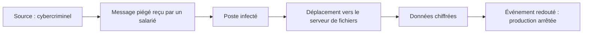

# Cours – Analyser les risques

*BTS SIO SISR 2e année – Bloc 3 – S02*

> Un mot ou un sigle inconnu ? Passe la souris dessus, ou ouvre le [glossaire](../../ressources/glossaire.md).

Tu sais désormais mettre en place des mesures de sécurité. Reste une question : **lesquelles, dans quel ordre, et pourquoi celles-là ?** Une organisation n'a ni le temps ni l'argent de tout protéger. L'**analyse de risques** sert à décider.

> [!NOTE]
> **Une méthode simplifiée.** Cette séance s'inspire de la méthode **EBIOS Risk Manager** publiée par l'ANSSI (démarche en cinq ateliers). Elle en garde l'esprit et allège le formalisme. Les échelles de gravité et de vraisemblance ci-dessous sont celles **de la séance** ; la méthode officielle a les siennes. Le guide de l'ANSSI reste la référence.

---

## 1. Le vocabulaire du risque

| Mot | Définition | Exemple (une menuiserie industrielle) |
|---|---|---|
| **Valeur métier** | Ce qui compte pour l'organisation : un service, une information, un savoir-faire | Fabriquer et livrer à temps ; garder confidentiels les plans des clients |
| **Bien support** | Ce sur quoi repose une valeur métier : serveur, poste, réseau, logiciel, local, personne | Le serveur de fichiers des plans ; la machine à commande numérique et son poste |
| **Événement redouté** | Ce qui arrive à une valeur métier et qu'on ne veut pas | Les plans sont publiés ; la production est à l'arrêt trois jours |
| **Source de risque** | Qui ou quoi peut provoquer l'événement | Un cybercriminel, un concurrent, un salarié mécontent |
| **Objectif visé** | Ce que la source cherche à obtenir | Une rançon, copier un savoir-faire, nuire |
| **Scénario** | L'enchaînement des étapes qui mène de la source à l'événement redouté | Message piégé → poste infecté → serveur de fichiers chiffré |
| **Risque** | Un scénario évalué par sa **gravité** et sa **vraisemblance** | Gravité forte, vraisemblance forte : risque élevé |

On retrouve les critères vus en première année : un événement redouté **atteint** la disponibilité, l'intégrité, la confidentialité ou la preuve d'une valeur métier.

---

## 2. La démarche en cinq étapes

| Étape | On répond à la question | On produit |
|---|---|---|
| **1. Cadrer** | Qu'est-ce qui compte, et qu'est-ce qui est déjà en place ? | Valeurs métier, biens supports, événements redoutés avec leur gravité, mesures existantes |
| **2. Sources de risque** | Qui pourrait nous nuire, et pour obtenir quoi ? | Couples source de risque / objectif visé, retenus selon leur pertinence |
| **3. Scénarios stratégiques** | Par quels chemins globaux (dont les **partenaires et prestataires**) peut-on atteindre nos valeurs ? | Quelques scénarios de haut niveau |
| **4. Scénarios opérationnels** | Comment, techniquement, étape par étape ? | Chaînes d'attaque, avec leur vraisemblance |
| **5. Traiter** | Que fait-on de chaque risque ? | Plan de traitement, risque résiduel |

Dans la séance, les étapes 3 et 4 sont regroupées en un seul tableau de **scénarios**.

> [!WARNING]
> **Un chemin d'attaque passe souvent par un tiers.** Un prestataire de maintenance, un hébergeur, un logiciel en ligne : s'ils sont compromis, ils ouvrent l'accès à l'organisation. Une analyse qui ne regarde que l'intérieur du réseau est incomplète.

---

## 3. Mesurer : gravité, vraisemblance, niveau de risque

**Gravité** de l'événement redouté pour l'organisation (échelle de la séance) :

| Niveau | Nom | Repère |
|---|---|---|
| 1 | Mineure | Gêne, rattrapable sans coût notable |
| 2 | Significative | Perturbation de quelques jours ou perte financière supportable |
| 3 | Grave | Arrêt d'une activité clé, atteinte à l'image, obligation de notification |
| 4 | Critique | Survie de l'organisation menacée |

**Vraisemblance** du scénario (échelle de la séance) :

| Niveau | Nom | Repère |
|---|---|---|
| 1 | Improbable | Demande des moyens très importants ou des conditions rares |
| 2 | Peu probable | Possible, mais demande de la compétence ou une circonstance particulière |
| 3 | Probable | Attaque courante, protections faibles |
| 4 | Très probable | Déjà arrivée, ou à la portée de n'importe qui, aucune protection |

**Niveau de risque = gravité × vraisemblance.**

| Produit | Niveau | Que fait-on ? |
|---|---|---|
| 1 à 3 | **Faible** | On accepte, on surveille |
| 4 à 8 | **Moyen** | On réduit si le coût est raisonnable |
| 9 à 16 | **Élevé** | On traite en priorité |

> [!NOTE]
> Une règle de bon sens complète le tableau : un événement de gravité **4** ne s'accepte pas sans que la direction l'ait décidé par écrit, même si le produit est faible.

---

## 4. Traiter un risque

Quatre décisions possibles :

| Décision | Sens | Exemple |
|---|---|---|
| **Réduire** | Ajouter des mesures qui baissent la gravité ou la vraisemblance | Sauvegarde isolée, cloisonnement du réseau |
| **Éviter** | Supprimer la cause | Ne plus exposer un service sur Internet |
| **Transférer** | Faire porter une partie du risque par un tiers | Assurance cyber, hébergement chez un prestataire (avec contrat) |
| **Accepter** | Décider en connaissance de cause de ne rien faire | Risque faible, coût de la mesure disproportionné |

Une mesure se choisit sur trois critères : **efficacité** (quel risque baisse-t-il, et de combien ?), **coût** (achat, temps, gêne pour les utilisateurs) et **délai**.

Après traitement, il reste un **risque résiduel** : on le réévalue avec les mêmes échelles et c'est la **direction** qui l'accepte, pas le technicien.

---

## 5. Une chaîne d'attaque, pas une liste de failles

Un scénario opérationnel se lit comme une histoire :

Chaque flèche est une **occasion de couper la chaîne** : filtrer le message, limiter les droits du poste, cloisonner le réseau, sauvegarder hors ligne. On choisit les mesures **là où elles coupent plusieurs scénarios à la fois**.

---

## 6. Ce que l'épreuve E7 attend

Dans l'étude de cas, on demande rarement « l'analyse EBIOS complète ». On demande de **repérer les risques dans le dossier documentaire**, de les **classer**, de **proposer des mesures** et de les **justifier**. La structure **risque → mesure → justification → limite** de la page [L'épreuve E7](../../ressources/epreuve-e7.md) est exactement le fruit de cette séance.

**Test flash.** Un hébergeur de messagerie est victime d'une attaque et les courriels d'une PME sont consultés. Quelle étape de la démarche aurait dû le faire apparaître ?

Voir la réponse

Les **scénarios stratégiques** : ils regardent les **partenaires et prestataires** comme chemins d'attaque. Mesures possibles : exigences de sécurité dans le contrat, chiffrement des données sensibles avant dépôt, authentification multifacteur sur le compte.

