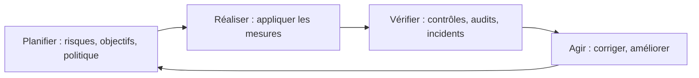
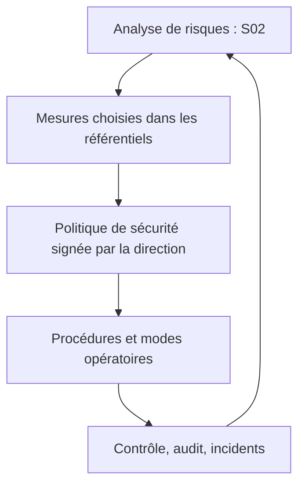

# Cours – Référentiels, normes et politique de sécurité

*BTS SIO SISR 2e année – Bloc 3 – S03*

> Un mot ou un sigle inconnu ? Passe la souris dessus, ou ouvre le [glossaire](../../ressources/glossaire.md).

L'analyse de risques (S02) dit **quoi** protéger en priorité. Cette séance répond à : **avec quelles bonnes pratiques reconnues, et comment l'organisation écrit-elle ses règles ?** On n'invente pas ses mesures : on s'appuie sur des **référentiels**, et on décide par écrit dans une **politique de sécurité**.

> [!WARNING]
> **Les intitulés, les versions et les numéros de mesures changent.** Cette page donne l'esprit et l'usage de chaque référentiel. Avant de citer une mesure précise dans un document, **relis le texte à jour** à la source.

---

## 1. Pourquoi des référentiels ?

- Ne pas partir d'une page blanche : des mesures éprouvées existent.
- **Parler le même langage** avec un client, un auditeur, un assureur.
- **Justifier** une mesure : « le guide d'hygiène de l'ANSSI la recommande » pèse plus que « je pense que ».
- **Mesurer** : on peut comparer son état à une liste.

Un référentiel n'est **pas** une analyse de risques : il dit ce qui se fait en général, pas ce qui compte **chez toi**. On utilise les deux ensemble : le risque choisit, le référentiel fournit les mesures.

---

## 2. Les grandes familles

| Référentiel | Nature | À quoi il sert |
|---|---|---|
| **ISO/IEC 27001** | Norme d'**exigences** d'un **système de management de la sécurité de l'information (SMSI)** | On peut être **certifié** : un organisme indépendant vérifie que l'organisation gère la sécurité de façon organisée et continue |
| **ISO/IEC 27002** | Guide de **bonnes pratiques** : catalogue de mesures | On y choisit des mesures ; on ne se fait **pas** certifier sur ce guide seul |
| **Guide d'hygiène informatique de l'ANSSI** | Recommandations **françaises**, accessibles, pour toute organisation | Un socle de base, très utilisé en France |
| **CIS Controls** (et guides de configuration CIS) | Mesures **priorisées** et guides de durcissement par système | Savoir par quoi commencer ; configurer un système précisément |
| **RGPD** | **Loi** européenne | Obligation de sécuriser les données personnelles (voir S04) |

> [!NOTE]
> **Norme, guide, loi : trois forces différentes.** Une loi s'**impose** ; une norme se **choisit** (et se certifie, s'il y a intérêt) ; un guide se **suit** ou non. Dans une étude de cas, repère laquelle de ces trois forces s'applique à l'organisation.

### Le SMSI et la roue d'amélioration continue

ISO/IEC 27001 demande de faire **vivre** la sécurité, pas de la poser une fois :

---

## 3. Les familles de mesures d'hygiène

Les guides se ressemblent. Les mesures se rangent en grandes familles, à connaître comme **plan de lecture** d'un dossier :

| Famille | Exemples de mesures |
|---|---|
| **Sensibiliser et former** | Charte, formation, exercices d'hameçonnage |
| **Connaître son système** | Inventaire des équipements, des logiciels, des comptes |
| **Authentifier et contrôler les accès** | Mots de passe robustes, multifacteur, moindre privilège, revue des droits |
| **Sécuriser les postes** | Mises à jour, chiffrement du disque, antivirus ou EDR, pas de droits d'administrateur |
| **Sécuriser le réseau** | Segmentation, filtrage, Wi-Fi sécurisé, accès distant protégé |
| **Sécuriser l'administration** | Comptes d'administration distincts, accès d'administration limités |
| **Gérer le nomadisme** | Postes portables chiffrés, connexion distante par VPN |
| **Maintenir à jour** | Correctifs, matériel et logiciels encore supportés |
| **Superviser, auditer, réagir** | Journaux, alertes, audit, plan de réponse à incident |
| **Sauvegarder et reprendre** | Sauvegarde isolée testée, plan de reprise |

---

## 4. La politique de sécurité (PSSI)

La **politique de sécurité du système d'information (PSSI)** est le document par lequel la **direction** dit : voici ce que nous protégeons, selon quels principes, et qui est responsable de quoi. Elle est **signée par la direction** : sans elle, la sécurité reste l'affaire d'un technicien seul.

Contenu type :

| Rubrique | Contenu |
|---|---|
| **Périmètre et enjeux** | Ce que couvre la politique ; les valeurs métier à protéger |
| **Principes** | Moindre privilège, défense en profondeur, sauvegardes, journalisation… |
| **Organisation** | Qui décide, qui administre, qui contrôle ; qui prévenir en cas d'incident |
| **Règles** | Mots de passe, postes, accès distant, supports amovibles, données personnelles… |
| **Contrôle et révision** | Audits, indicateurs, date de révision, sanctions |

### Politique, procédure, mode opératoire

| Niveau | Question | Exemple |
|---|---|---|
| **Politique** | Que veut-on, pourquoi ? | « Les données sont sauvegardées et la restauration est testée. » |
| **Procédure** | Qui fait quoi, quand ? | « Chaque mois, l'administrateur teste une restauration et en rend compte à la direction. » |
| **Mode opératoire** | Comment, geste par geste ? | « Étapes pour restaurer un dossier depuis le NAS. » |

### La charte d'usage

La **charte informatique** est le versant **utilisateur** : ce qu'on a le droit et l'interdiction de faire avec les moyens de l'entreprise, ce que l'entreprise surveille et pourquoi. Elle gagne à être courte, claire et **annexée au règlement intérieur** pour être opposable (point à vérifier avec le service juridique ; voir S04).

---

## 5. Relier risque, référentiel et politique

**Test flash.** Une PME dit : « nous sommes conformes à ISO/IEC 27002 ». Pourquoi cette phrase ne prouve-t-elle rien à un client ?

Voir la réponse

ISO/IEC 27002 est un **guide de mesures**, pas une norme de certification : on ne peut pas s'y faire certifier. La preuve attendue serait une certification **ISO/IEC 27001** (un SMSI audité), ou à défaut un **audit** ou une **liste de mesures appliquées** vérifiable.

