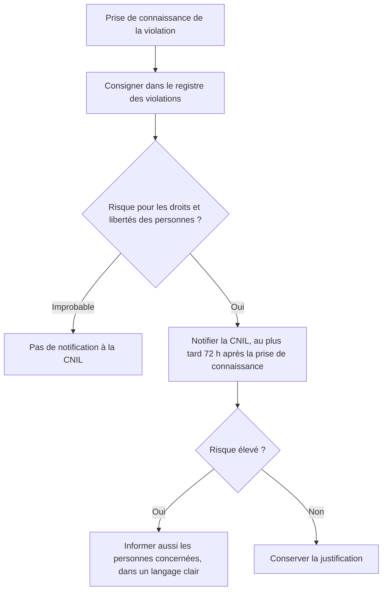

# Cours – Cadre juridique et responsabilités en entreprise

*BTS SIO SISR 2e année – Bloc 3 – S04*

> Un mot ou un sigle inconnu ? Passe la souris dessus, ou ouvre le [glossaire](../../ressources/glossaire.md).

> [!WARNING]
> **Ce cours n'est pas un conseil juridique.** Il donne les repères que l'étude de cas de l'épreuve E7 demande. Les articles, les montants et les délais sont à **relire sur Légifrance et sur le site de la CNIL** avant d'être cités dans un document noté. Si un point est à vérifier, c'est écrit.

Tu connais les bases du RGPD (première année). Cette séance l'applique à la vie d'une entreprise : **qui est responsable de quoi, quand une obligation naît, et ce que risque l'administrateur lui-même.**

---

## 1. Qualifier : qui fait quoi dans un traitement ?

Avant toute décision, on **qualifie** la situation :

| Question | Pourquoi elle compte |
|---|---|
| Quelles **données** ? Sont-elles **personnelles** ? **Sensibles** (santé, opinions, biométrie…) ? | Le régime et la gravité changent |
| Quelle **finalité** ? | Toute donnée a un but précis, écrit |
| Quelle **base légale** ? | Contrat, obligation légale, consentement, intérêt légitime… |
| Qui est **responsable de traitement** ? | Il décide des finalités et des moyens, et **répond** devant la loi |
| Qui est **sous-traitant** ? | Il traite pour le compte du responsable, sur instruction |
| Quelle **durée de conservation** ? | Pas de conservation sans limite |

Un même prestataire peut être **sous-traitant** pour un traitement (il héberge) et **responsable** pour un autre (ses propres clients). C'est la **réalité des décisions** qui qualifie, pas l'étiquette du contrat.

---

## 2. Les sous-traitants

Quand une organisation confie des données personnelles à un prestataire (hébergeur, éditeur en ligne, société de paie, maintenance), le RGPD (**art. 28**) exige un **contrat écrit** qui prévoit notamment :

- l'objet, la durée, la nature du traitement et les catégories de données ;
- le traitement **uniquement sur instruction** du responsable ;
- la **confidentialité** des personnes habilitées ;
- les **mesures de sécurité** ;
- le recours à un **autre sous-traitant** seulement avec accord ;
- l'**aide** au responsable (droits des personnes, violations) ;
- la **suppression ou restitution** des données en fin de contrat ;
- le droit de **contrôle et d'audit**.

Le responsable doit choisir un prestataire qui présente des **garanties suffisantes**. Si le prestataire est compromis, **le responsable reste concerné** : « c'est le prestataire » ne l'exonère pas.

> [!NOTE]
> **Données de santé.** En France, l'hébergement de données de santé à caractère personnel recueillies à l'occasion de soins relève d'un **régime particulier** : l'hébergeur doit être **certifié** pour cette activité. À vérifier sur le site de l'agence du numérique en santé avant de conclure.

---

## 3. Les transferts hors de l'Union européenne

Envoyer des données personnelles **hors de l'Union européenne** (par exemple vers un service en ligne dont les serveurs ou l'assistance sont dans un pays tiers) n'est permis que si un **cadre de protection** existe (RGPD, chapitre V) :

| Mécanisme | Idée |
|---|---|
| **Décision d'adéquation** | La Commission européenne reconnaît que le pays assure un niveau de protection équivalent |
| **Garanties appropriées** | Notamment des **clauses contractuelles types** signées avec l'importateur, parfois avec des mesures complémentaires |
| **Règles d'entreprise contraignantes** | Pour les groupes multinationaux |

Question à se poser dans un dossier : **où sont les serveurs, et qui peut y accéder (y compris l'assistance) ?** Une adresse de société en Europe n'implique pas que les données y restent. Les décisions d'adéquation et les accords évoluent : **à vérifier à la date du sujet**.

---

## 4. Le délégué à la protection des données et la CNIL

- Le **délégué à la protection des données (DPO)** conseille et contrôle ; il est **obligatoire** dans certains cas (autorités publiques, suivi à grande échelle, données sensibles à grande échelle) et **désignable** dans les autres. Il ne reçoit **pas d'instruction** sur sa mission et n'est pas responsable à la place de l'organisation.
- La **CNIL** informe, contrôle, **instruit les plaintes**, peut **mettre en demeure** et **sanctionner**.
- Les **sanctions** pécuniaires du RGPD peuvent aller, selon la gravité des manquements, jusqu'à **10 millions d'euros ou 2 %** du chiffre d'affaires mondial, ou **20 millions d'euros ou 4 %** (art. 83) : à vérifier sur le texte.

---

## 5. La violation de données

Une **violation de données** est une atteinte à la **sécurité** qui entraîne, de manière accidentelle ou illicite, la **destruction**, la **perte**, l'**altération**, la **divulgation** ou l'**accès** non autorisé à des données personnelles. Elle recouvre la confidentialité, l'intégrité **et la disponibilité**.

Points à retenir :

- Le délai de **72 heures** court à partir du moment où l'on **en a eu connaissance** ; au-delà, la notification est faite avec les **motifs du retard**.
- Le **sous-traitant** informe le responsable **dans les meilleurs délais** (art. 33) : le contrat doit prévoir comment.
- **Toute** violation est consignée dans un **registre**, même non notifiée.
- Un **chiffrement** bien fait peut rendre les données inintelligibles et **réduire le risque** (disque d'un portable perdu).
- La notification contient : la nature de la violation, les catégories et le nombre approximatif de personnes et d'enregistrements, les **conséquences probables**, les **mesures** prises ou proposées, et un contact.

> [!NOTE]
> **Au-delà du RGPD.** Selon le secteur (opérateurs de services essentiels, entités importantes ou essentielles), d'**autres obligations de sécurité et de notification d'incident** s'ajoutent, issues du cadre européen « NIS 2 ». Sa transposition en droit français **évolue** : vérifier son état à la date du sujet avant d'en parler. Si le dossier la cite, on la **cite**, sans en inventer le détail.

---

## 6. L'administrateur face à la loi

L'administrateur système et réseau dispose de droits techniques étendus : la loi le sait, et lui demande **plus**, pas moins.

### Les atteintes aux systèmes (loi dite « Godfrain »)

Le **Code pénal** (art. **323-1 et suivants**) punit notamment :

| Fait | Article |
|---|---|
| **Accéder** ou **se maintenir** frauduleusement dans un système | 323-1 |
| **Entraver** ou **fausser** le fonctionnement d'un système | 323-2 |
| **Introduire, extraire, modifier ou supprimer** frauduleusement des données | 323-3 |
| Détenir ou diffuser un **outil conçu pour commettre** ces infractions, sans motif légitime | 323-3-1 |

Les peines (emprisonnement et amende, aggravées si le système contient des données personnelles ou relève de l'État) sont à **relire sur Légifrance**. L'élément qui compte pour toi : l'accès est **frauduleux** s'il se fait **sans autorisation**. **Avoir un mot de passe d'administrateur n'est pas une autorisation d'aller partout.** D'où la règle de la formation : on ne teste **jamais** sans **autorisation écrite** et **périmètre défini**.

### Le secret des correspondances et la vie privée

- Le **secret des correspondances** est protégé (Code pénal, art. **226-15** : ouverture ou interception frauduleuse).
- Un salarié conserve un droit au respect de sa **vie privée** sur son lieu de travail. Les fichiers et messages **clairement identifiés comme personnels** sont, en principe, protégés ; l'employeur n'y accède que dans des **cas encadrés** (point à vérifier avec un juriste).
- L'administrateur est tenu à la **confidentialité** de ce qu'il voit en exerçant sa mission ; elle se prévoit dans la **charte** et le **contrat**.
- La **surveillance** des salariés (journaux, filtrage) doit être **proportionnée**, **annoncée** (charte, information des représentants du personnel selon le cas) et **justifiée**.

### Responsabilité civile et pénale

| Responsabilité | Qui ? | Idée |
|---|---|---|
| **Pénale** | La **personne** qui commet l'infraction, dont l'administrateur à titre personnel | Il ne peut pas se retrancher derrière un ordre illégal |
| **Civile** | L'**employeur** répond de ses salariés dans leurs fonctions ; le **prestataire** répond selon son contrat | Réparation du dommage |
| **Contractuelle** | Le prestataire envers son client | Selon les clauses (obligation de moyens ou de résultat, plafonds) |

**Test flash.** Un administrateur voit passer un dossier « Perso » du directeur sur le serveur. A-t-il le droit de l'ouvrir « pour vérifier qu'il n'y a pas de virus » ?

Voir la réponse

**Non, en principe.** Un dossier clairement identifié comme personnel est protégé ; l'ouvrir sans cadre légal ni procédure peut constituer une atteinte à la vie privée ou au secret des correspondances. La bonne pratique : s'en tenir à des **mesures techniques** (analyse antivirus automatique), ne **pas lire le contenu**, et référer à la direction ou à un juriste si une ouverture paraît nécessaire.

