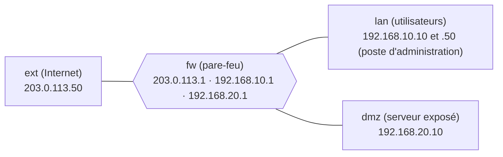

# TP – Un pare-feu à trois zones

*BTS SIO SISR 2e année – Bloc 3 – S05 – en binôme : un tape, l'autre lit ; on échange les rôles à chaque partie*

> [!NOTE]
> **But.** Concevoir la **matrice de flux** d'un petit réseau (utilisateurs, DMZ, Internet), l'écrire en règles **nftables**, puis **prouver** par des tests que tout ce qui est interdit l'est vraiment.
>
> **Durée :** 3 h 10. **Prérequis :** [cours S05](01-cours.md) lu ; S01 (premières règles nftables).

> [!NOTE]
> **Comment ce TP fonctionne.** Avant de manipuler, tu écris ce que tu **anticipes** (« J'anticipe »). Puis tu testes et tu notes ce que tu **constates**. Un **bilan de compétences** clôt la séance.

**Binôme :** ____________ / ____________

## Le laboratoire

Pour que chacun dispose d'un réseau complet **sans quatre machines**, le laboratoire tient dans **une seule machine virtuelle Debian**, qui simule quatre « machines » grâce à des **espaces de noms réseau** (*network namespaces*) : chacun a ses propres interfaces, adresses et règles, comme une machine séparée.



| Zone | Réseau | Machine | Rôle |
|---|---|---|---|
| **lan** | `192.168.10.0/24` | `.10` poste d'un salarié, `.50` **poste d'administration** | Utilisateurs |
| **dmz** | `192.168.20.0/24` | `.10` serveur web et SSH | Serveur exposé |
| **ext** | `203.0.113.0/24` | `.50` | Internet (adresses de documentation) |
| **fw** | trois interfaces | `.1` de chaque réseau | Pare-feu et routeur |

**Contraintes.**

- Une machine virtuelle **Debian** avec un compte `sudo`. Paquets nécessaires : `nftables`, `iproute2`, `curl`, `netcat-openbsd`, `python3`, `iputils-ping` (`sudo apt install …` si l'un manque).
- **Instantané** de la machine avant de commencer.
- Tout se passe **dans la machine** : le réseau de la salle n'est pas touché.
- Tu **notes la sortie** de chaque test (capture d'écran datée).

---

## Partie A – Concevoir la matrice de flux (≈ 30 min)

### Le besoin

Une PME a un **site web public** et des postes d'utilisateurs. Un seul serveur, en **DMZ**, héberge le site. Les besoins exprimés :

1. Les **visiteurs** (Internet) accèdent au site en **HTTPS** uniquement.
2. Les **utilisateurs** accèdent au site (HTTP et HTTPS) pour le tester et, vers Internet, au **web** (HTTP et HTTPS) et au **DNS**.
3. L'**administrateur** gère le serveur en **SSH**, **depuis son poste d'administration uniquement** (`192.168.10.50`).
4. Le serveur doit pouvoir **se mettre à jour** (HTTPS et DNS vers Internet).
5. **Rien** ne doit pouvoir joindre le réseau des utilisateurs, ni depuis Internet, ni depuis la DMZ.

### A1 – La matrice

**J'anticipe.** Quel est, à ton avis, le flux le plus dangereux à ouvrir ? ______________________

Complète la matrice (ports et protocoles, ou « rien ») :

| Source ↓ / Destination → | LAN | DMZ | Internet |
|---|---|---|---|
| **LAN** | — | | |
| **DMZ** | | — | |
| **Internet** | | | — |

### A2 – Des règles à la matrice

**Je comprends.** Combien de cases de ta matrice sont **vides** ? Qu'écris-tu pour elles dans le pare-feu ? ______________________

---

## Partie B – Monter le laboratoire (≈ 25 min)

### B1 – Le script

Crée le fichier `lab-zones.sh` (`nano lab-zones.sh`), colle le contenu ci-dessous, puis rends-le exécutable.

```bash
#!/bin/bash
# Laboratoire de zones : 4 espaces réseau (fw, lan, dmz, ext) dans une seule machine.
# Usage : sudo ./lab-zones.sh up | services | down
set -e
case "$1" in
up)
  for n in fw lan dmz ext; do ip netns add $n; ip netns exec $n ip link set lo up; done
  # liaisons : chaque zone est reliée au pare-feu par un câble virtuel
  ip link add lan0 type veth peer name fwlan
  ip link add dmz0 type veth peer name fwdmz
  ip link add ext0 type veth peer name fwext
  ip link set lan0 netns lan; ip link set fwlan netns fw
  ip link set dmz0 netns dmz; ip link set fwdmz netns fw
  ip link set ext0 netns ext; ip link set fwext netns fw
  # adresses
  ip -n fw  addr add 192.168.10.1/24 dev fwlan
  ip -n fw  addr add 192.168.20.1/24 dev fwdmz
  ip -n fw  addr add 203.0.113.1/24  dev fwext
  ip -n lan addr add 192.168.10.10/24 dev lan0
  ip -n lan addr add 192.168.10.50/24 dev lan0
  ip -n dmz addr add 192.168.20.10/24 dev dmz0
  ip -n ext addr add 203.0.113.50/24  dev ext0
  ip -n fw  link set fwlan up; ip -n fw link set fwdmz up; ip -n fw link set fwext up
  ip -n lan link set lan0 up;  ip -n dmz link set dmz0 up;  ip -n ext link set ext0 up
  ip -n lan route add default via 192.168.10.1
  ip -n dmz route add default via 192.168.20.1
  ip -n ext route add default via 203.0.113.1
  ip netns exec fw sysctl -qw net.ipv4.ip_forward=1
  echo "laboratoire prêt" ;;
services)
  # petits services de test (de simples écouteurs, pas de vrais serveurs)
  ip netns exec dmz sh -c 'python3 -m http.server 80  --bind 192.168.20.10 >/dev/null 2>&1 &'
  ip netns exec dmz sh -c 'python3 -m http.server 443 --bind 192.168.20.10 >/dev/null 2>&1 &'
  ip netns exec dmz sh -c 'nc -lk -p 22 >/dev/null 2>&1 &'
  ip netns exec lan sh -c 'python3 -m http.server 8080 --bind 192.168.10.10 >/dev/null 2>&1 &'
  ip netns exec ext sh -c 'python3 -m http.server 443 --bind 203.0.113.50 >/dev/null 2>&1 &'
  sleep 2; echo "services lancés" ;;
down)
  for n in fw lan dmz ext; do ip netns pids $n 2>/dev/null | xargs -r kill; ip netns del $n 2>/dev/null || true; done
  echo "laboratoire supprimé" ;;
*) echo "usage : $0 up|services|down"; exit 1 ;;
esac
```

```bash
chmod +x lab-zones.sh
sudo ./lab-zones.sh up
sudo ./lab-zones.sh services
```

**Je comprends.** Les « services » sont des écouteurs minimalistes : un serveur web sur les ports 80 et 443 de la DMZ (l'écouteur du port 443 ne fait pas de chiffrement : seul le **filtrage** nous intéresse ici), un écouteur sur le port 22, un service de test sur le poste d'un utilisateur (port 8080) et un « site » sur Internet (port 443).

> [!NOTE]
> **Pour exécuter une commande « dans » une zone :** `sudo ip netns exec NOM commande`. Exemple : `sudo ip netns exec lan ip -br a` affiche les adresses de la zone `lan`.

### B2 – Vérifier avant de filtrer

**J'anticipe.** Sans aucune règle, qui peut joindre qui ? ______________________

```bash
sudo ip netns exec lan ip -br a
sudo ip netns exec ext curl -s -m 2 -o /dev/null -w "%{http_code}\n" http://192.168.10.10:8080
sudo ip netns exec dmz curl -s -m 2 -o /dev/null -w "%{http_code}\n" http://192.168.10.10:8080
```

<details markdown="1">
<summary>Éléments de réponse</summary>

`200` aux deux derniers tests : **sans filtre, Internet et la DMZ atteignent le réseau des utilisateurs.** C'est exactement ce qu'on veut interdire. (Si le premier test échoue, attends deux secondes que les services démarrent et relance.)

</details>

**Point de contrôle :** capture des trois commandes, avec le résultat `200`.

---

## Partie C – Écrire les règles (≈ 55 min)

### C1 – Le squelette

Crée `/root/filtre-zones.nft` (`sudo nano /root/filtre-zones.nft`). Le **pare-feu lui-même** (chaîne `entrant`) est donné ; la chaîne **`transit`** est à compléter **à partir de ta matrice**.

```text
#!/usr/sbin/nft -f
flush ruleset

define LAN   = 192.168.10.0/24
define ADMIN = 192.168.10.50

table inet zones {
  chain entrant {
    type filter hook input priority 0; policy drop;
    ct state established,related accept
    ct state invalid drop
    iifname "lo" accept
    iifname "fwlan" ip protocol icmp icmp type echo-request accept
  }
  chain transit {
    type filter hook forward priority 0; policy drop;
    ct state established,related accept
    ct state invalid drop

    # --- À COMPLÉTER : une règle par case non vide de ta matrice ---
    # utilisateurs -> DMZ : web
    # poste d'administration -> DMZ : SSH
    # utilisateurs -> Internet : web et DNS
    # Internet -> DMZ : HTTPS
    # DMZ -> Internet : mises à jour (HTTPS et DNS)

    # --- tout le reste : on compte, on journalise (au plus 5 par minute), puis la politique refuse ---
    counter limit rate 5/minute log prefix "REFUS-TRANSIT "
  }
}
```

**Aide à la syntaxe.**

| Besoin | Écriture |
|---|---|
| Zone d'entrée et de sortie | `iifname "fwlan" oifname "fwdmz"` (noms des interfaces du pare-feu : `fwlan`, `fwdmz`, `fwext`) |
| Source dans un réseau ou une adresse | `ip saddr $LAN` ou `ip saddr $ADMIN` |
| Un port TCP, plusieurs ports | `tcp dport 22` ; `tcp dport { 80, 443 }` |
| Le DNS | `udp dport 53` |
| Verdict | `accept` |

### C2 – Vérifier la syntaxe, puis appliquer

```bash
sudo ip netns exec fw nft -c -f /root/filtre-zones.nft && echo "syntaxe valide"
sudo ip netns exec fw nft -f /root/filtre-zones.nft
sudo ip netns exec fw nft list ruleset
```

**Je comprends.** `nft -c` **vérifie sans appliquer** ; `ip netns exec fw` applique les règles **dans l'espace du pare-feu** et pas dans la machine entière : ta propre session reste donc ouverte quoi que tu écrives.

**Retour arrière :** `sudo ip netns exec fw nft flush ruleset`.

**Point de contrôle :** capture de `nft list ruleset`.

---

## Partie D – Prouver (≈ 50 min)

### D1 – Les tests

Écris d'abord ce que tu **attends** (« passe » ou « bloqué »), puis lance chaque test et note ce que tu **constates**. Les commandes se lancent dans la machine virtuelle, avec `sudo` devant.

| N° | Test | J'attends | Je constate |
|---|---|---|---|
| 1 | `ip netns exec lan curl -s -m 2 -o /dev/null -w "%{http_code}\n" http://192.168.20.10:80` (utilisateur → web de la DMZ) | | |
| 2 | `ip netns exec lan curl -s -m 2 -o /dev/null -w "%{http_code}\n" http://192.168.20.10:443` | | |
| 3 | `ip netns exec ext curl -s -m 2 -o /dev/null -w "%{http_code}\n" http://192.168.20.10:443` (Internet → HTTPS de la DMZ) | | |
| 4 | `ip netns exec ext curl -s -m 2 -o /dev/null -w "%{http_code}\n" http://192.168.20.10:80` (Internet → HTTP de la DMZ) | | |
| 5 | `ip netns exec lan nc -z -w 2 -s 192.168.10.50 192.168.20.10 22` (SSH depuis le poste d'**administration**) | | |
| 6 | `ip netns exec lan nc -z -w 2 -s 192.168.10.10 192.168.20.10 22` (SSH depuis un poste **ordinaire**) | | |
| 7 | `ip netns exec ext nc -z -w 2 192.168.20.10 22` (SSH depuis Internet) | | |
| 8 | `ip netns exec dmz curl -s -m 2 -o /dev/null -w "%{http_code}\n" http://192.168.10.10:8080` (DMZ → utilisateurs) | | |
| 9 | `ip netns exec ext curl -s -m 2 -o /dev/null -w "%{http_code}\n" http://192.168.10.10:8080` (Internet → utilisateurs) | | |
| 10 | `ip netns exec lan curl -s -m 2 -o /dev/null -w "%{http_code}\n" http://203.0.113.50:443` (utilisateur → Internet) | | |
| 11 | `ip netns exec dmz curl -s -m 2 -o /dev/null -w "%{http_code}\n" http://203.0.113.50:443` (DMZ → Internet) | | |
| 12 | `ip netns exec lan ping -c 1 -W 1 192.168.10.1` (ping du pare-feu) | | |
| 13 | `ip netns exec lan ping -c 1 -W 1 192.168.20.10` (ping de la DMZ) | | |

> [!NOTE]
> Un test **bloqué** affiche `000` (pour `curl`) ou ne dit rien (pour `nc -z`), après environ deux secondes ; un test **passé** affiche `200` (pour `curl`) ou `succeeded!` (pour `nc -z`). Si le premier test échoue alors qu'il devrait passer, relance-le : les services viennent de démarrer.

<details markdown="1">
<summary>Éléments de réponse</summary>

Passent : **1, 2, 3, 5, 10, 11, 12**. Bloqués : **4, 6, 7, 8, 9, 13**. Les tests 6 et 7 montrent que SSH n'est ouvert **que** depuis le poste d'administration ; les tests 8 et 9 que ni la DMZ ni Internet n'atteignent les utilisateurs ; le test 13 que le ping de la DMZ n'est pas autorisé (aucune règle ne l'écrit).

</details>

**Je comprends.** Pourquoi le test 5 réussit-il et le test 6 échoue-t-il, alors que les deux viennent de la zone `lan` ? ______________________

### D2 – Mesurer ce qui est refusé

```bash
sudo ip netns exec fw nft list chain inet zones transit | grep counter
```

**J'anticipe.** Le compteur augmente-t-il quand tu relances le test 9 ? De combien de paquets à peu près ? ______________________

Relance deux fois le test 9, puis relis le compteur : ______________________

<details markdown="1">
<summary>Éléments de réponse</summary>

Chaque test refusé ajoute **environ 2 paquets** au compteur : `curl` envoie sa demande de connexion (SYN), puis la **renvoie une fois** faute de réponse. Après deux tests : 4 paquets (si le compteur partait de 0 au chargement des règles).

</details>

**Je comprends.** Le compteur est la **mesure** de ce que le pare-feu a refusé : un chiffre qui monte d'un coup est un signal à surveiller (séance S11).

### D3 – Un test qui doit échouer

Ajoute **volontairement** une règle trop large **avant** les règles précises, dans la chaîne `transit` :

```text
    iifname "fwext" accept
```

Recharge le fichier (`sudo ip netns exec fw nft -f /root/filtre-zones.nft`) et relance les tests **4, 7 et 9**. Que constates-tu ? ______________________

Retire la ligne, recharge, et vérifie que les tests 4, 7 et 9 sont de nouveau **bloqués**.

**Je comprends.** Une règle large placée tôt **annule** les règles suivantes : relire l'**ordre** des règles est une vérification en soi.

---

## Partie E – Bilan et démontage (≈ 20 min)

### E1 – La matrice comme preuve

Complète la matrice finale, **telle qu'elle est prouvée par tes tests** (renvoie au numéro de test) :

| Flux | Autorisé ? | Prouvé par le test n° |
|---|---|---|
| Utilisateurs → DMZ web | | |
| Admin → DMZ SSH | | |
| Poste ordinaire → DMZ SSH | | |
| Internet → DMZ HTTPS | | |
| Internet → DMZ HTTP | | |
| DMZ → utilisateurs | | |
| Internet → utilisateurs | | |

### E2 – Les limites

**Je comprends.** Cite **deux** attaques que ce pare-feu **ne bloque pas**, même s'il est parfait : ______________________

### E3 – Démonter

```bash
sudo ./lab-zones.sh down
```

---

## Pour aller plus loin

- Ajoute, dans la chaîne `transit`, une règle `reject` (au lieu du `drop` par défaut) pour la DMZ vers le LAN, puis compare le comportement du test 8.
- Place les adresses autorisées dans un **ensemble** nftables (`set`) plutôt que dans chaque règle.
- Lis le journal du noyau (`sudo dmesg | grep REFUS`) : les messages d'un espace de noms n'y apparaissent que si la machine l'autorise (`sudo sysctl -w net.netfilter.nf_log_all_netns=1`). Cette étape n'a pas été vérifiée par l'auteur.

## Retour en entreprise (si ta situation le permet)

- **Observer :** existe-t-il dans ton entreprise un **schéma des zones** ou une **matrice de flux** ? À jour ?
- **Documenter :** dessine en demi-page la segmentation réelle de ton entreprise (zones, flux autorisés) et compare-la à ta matrice.

## Rendu

Compte rendu **PDF**, nommé `RENDU-B3A2-S05-NOM.pdf`, contenant : la matrice de la partie A, le fichier de règles complet, les captures des tests D1 avec leurs résultats, la réponse à D3 et la matrice prouvée de E1.

## Bilan de la séance

| Compétence du référentiel | Ce que j'ai fait dans cette séance | Niveau |
|---|---|---|
| **B3.4** – Garantir la disponibilité, l'intégrité et la confidentialité des services informatiques et des données de l'organisation face à des cyberattaques | | |
| **B3.5A** – Assurer la cybersécurité d'une infrastructure réseau, d'un système, d'un service | | |

> [!NOTE]
> Le choix des compétences pour cette séance est une proposition à valider.

**Je sais faire, sans aide :**

- [ ] Écrire une matrice de flux à partir d'un besoin ;
- [ ] Traduire une case de la matrice en règle nftables ;
- [ ] **Prouver** un filtrage par des tests positifs **et négatifs** ;
- [ ] Expliquer pourquoi l'ordre des règles compte ;
- [ ] Dire ce que le filtrage ne couvre pas.

**Ce que je dois reprendre :** ______________________
