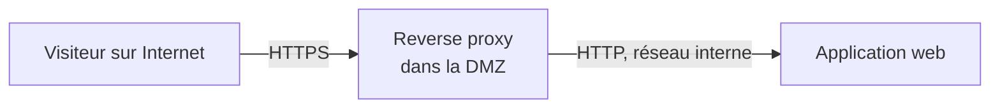

# Cours – Sécuriser les services web : reverse proxy, en-têtes et OWASP

*BTS SIO SISR 2e année – Bloc 3 – S08*

> Un mot ou un sigle inconnu ? Passe la souris dessus, ou ouvre le [glossaire](../../ressources/glossaire.md).

Le serveur web est le service **le plus exposé** d'une organisation : c'est celui qu'on publie sur Internet (la DMZ de la séance S05). Cette séance montre comment **le protéger sans modifier l'application**, grâce à un **reverse proxy**, et ce que le proxy ne peut pas faire.

---

## 1. Le reverse proxy

Un **reverse proxy** est un serveur placé **devant** une ou plusieurs applications. Les visiteurs ne parlent **qu'à lui** ; c'est lui qui relaie les requêtes vers l'application, qui reste **cachée** derrière.



| Ce qu'il apporte | Comment |
|---|---|
| **TLS en un seul point** | Le chiffrement et le certificat sont gérés sur le proxy, pas dans chaque application |
| **Masquage de l'application** | Le visiteur ne voit ni sa version ni son adresse |
| **Filtrage des requêtes** | Méthodes autorisées, taille maximale, limitation du débit |
| **En-têtes de sécurité** | Ajoutés pour **toutes** les applications, au même endroit |
| **Répartition et reprise** | Plusieurs serveurs derrière un seul point d'entrée (voir le bloc 2) |
| **Journal unique** | Toutes les requêtes passent au même endroit |

---

## 2. Le TLS bien réglé

- Ne garder que les versions **récentes** du protocole (TLS 1.2 et 1.3) ; **désactiver** les anciennes.
- **Rediriger** HTTP vers HTTPS (réponse 301) : on ne sert rien en clair.
- **HSTS** : l'en-tête `Strict-Transport-Security` demande au navigateur de **n'utiliser que HTTPS** pour ce site, pendant une durée donnée.
- Le **certificat** vient d'une autorité reconnue en production ; il est **renouvelé** avant son expiration (un certificat expiré est une **panne**, pas seulement une alerte).

---

## 3. Les en-têtes de sécurité

Des **en-têtes de réponse** demandent au navigateur de se protéger :

| En-tête | Effet |
|---|---|
| `Strict-Transport-Security` | Navigateur : uniquement HTTPS pour ce site |
| `X-Content-Type-Options: nosniff` | Interdit au navigateur de **deviner** le type d'un fichier (évite qu'un fichier soit exécuté comme un script) |
| `X-Frame-Options: DENY` (ou la directive `frame-ancestors` de la politique de contenu) | Interdit d'afficher la page dans un **cadre** d'un autre site (détournement de clic) |
| `Content-Security-Policy` | Liste **d'où** la page peut charger scripts, images, styles : limite l'effet d'une **injection de script** |
| `Referrer-Policy` | Contrôle ce qui est transmis comme origine d'un clic |

Ces en-têtes ne **remplacent pas** la correction des failles : ils **réduisent les dégâts** si une faille existe.

### Ne pas bavarder

Les réponses ne doivent pas annoncer le **nom et la version** du serveur (`Server: nginx/1.24.0`) : c'est un **cadeau** à un attaquant qui cherche des failles connues de cette version. On les masque, **sur tous** les sites du serveur (pas seulement sur le site principal).

---

## 4. Limiter ce qui est inutile

| Mesure | Pourquoi |
|---|---|
| N'accepter que les **méthodes** utiles (`GET`, `HEAD`, `POST`) | Réduire la surface (`PUT`, `DELETE`, `TRACE`…) |
| **Limiter le débit** par adresse | Freiner les essais répétés (mots de passe) et le moissonnage |
| Limiter la **taille** des requêtes | Éviter l'envoi de fichiers énormes |
| Fixer des **délais** (connexion, lecture) | Se protéger des connexions lentes qui monopolisent le serveur |

---

## 5. Les failles d'applications (OWASP)

L'**OWASP** (communauté ouverte sur la sécurité des applications) publie une liste des **risques les plus fréquents** des applications web (le « Top 10 »). Les **familles** à connaître :

| Famille | Idée | Exemple |
|---|---|---|
| **Contrôle d'accès défaillant** | Un utilisateur accède à ce qui ne lui est pas destiné | Changer un numéro dans l'adresse pour voir la facture d'un autre |
| **Défaut de chiffrement** | Données sensibles non protégées | Mot de passe transmis en clair |
| **Injection** | Une donnée saisie est **interprétée comme une commande** | `' OR '1'='1` dans un champ de connexion (SQL) ; script injecté dans une page (XSS) |
| **Conception non sécurisée** | La faille est dans l'**architecture** | Aucune limitation des essais de connexion |
| **Mauvaise configuration** | Configuration par défaut, messages d'erreur détaillés | Page d'administration accessible à tous |
| **Composants vulnérables** | Bibliothèque ou logiciel non à jour | Une version de composant avec une faille connue |
| **Authentification défaillante** | Mots de passe faibles, sessions mal gérées | Pas de limitation des essais, pas de second facteur |
| **Défaut d'intégrité** | Mises à jour ou données non vérifiées | Dépendance téléchargée sans vérification |
| **Journalisation insuffisante** | On ne voit pas l'attaque | Aucun journal des échecs de connexion |
| **Falsification de requête côté serveur** | Le serveur est amené à joindre une cible choisie par l'attaquant | Une fonction « récupérer une image par adresse » qui atteint le réseau interne |

> [!NOTE]
> L'intitulé, l'ordre et le nombre de catégories **changent** d'une édition à l'autre de la liste : cite la **famille** et vérifie la liste à jour avant de citer un rang.

### Ce que ne fait pas le reverse proxy

Un proxy **qui ne regarde que les en-têtes et le débit** ne corrige **pas** une injection SQL ou un contrôle d'accès défaillant : ces failles sont **dans l'application**. Un **pare-feu applicatif web (WAF)** analyse le **contenu** des requêtes et bloque des motifs d'attaque connus. Il aide, mais :

- il peut **laisser passer** une attaque inconnue ;
- il peut **bloquer** un usage légitime (faux positif) ;
- il ne **remplace pas** la correction de l'application : c'est un **pansement** qui gagne du temps.

---

## 6. Vérifier

On ne croit pas qu'un site est protégé : on **regarde** ses réponses.

```text
curl -I https://site     # en-têtes de la réponse
curl -v https://site     # détail de la connexion TLS
```

**Test flash.** Un site affiche `Server: Apache/2.4.x (Debian)` et `X-Powered-By: PHP/8.x`. Quelle mesure, et quel risque évite-t-elle ?

<details markdown="1">
<summary>Voir la réponse</summary>

**Masquer** le nom et la version du serveur et du langage. Cela n'empêche pas une attaque, mais **retire à l'attaquant l'information** qui lui permet de choisir une faille connue pour cette version (reconnaissance). Ça ne **dispense pas** de mettre le logiciel à jour.

</details>
