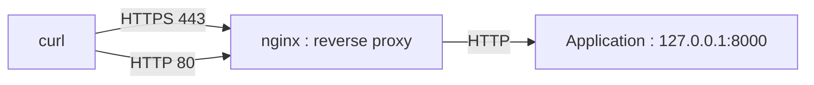

# TP – Un reverse proxy durci devant une application

*BTS SIO SISR 2e année – Bloc 3 – S08 – en binôme : un tape, l'autre lit ; on échange les rôles à chaque partie*

> [!NOTE]
> **But.** Placer un **reverse proxy nginx** devant une petite application, y régler **TLS**, les **en-têtes de sécurité**, les **méthodes** et le **débit**, **prouver** chaque réglage avec `curl`, puis constater **ce que le proxy ne bloque pas**.
>
> **Durée :** 3 h 10. **Prérequis :** [cours S08](01-cours.md) lu.

> [!NOTE]
> **Comment ce TP fonctionne.** Tu **anticipes** (« J'anticipe »), tu testes, tu notes ce que tu **constates**, puis tu expliques (« Je comprends »). Un **bilan de compétences** clôt la séance.

**Binôme :** ____________ / ____________

## Le laboratoire

Une **seule machine virtuelle Debian**, avec un compte `sudo` : l'**application** (un petit serveur web local) écoute sur `127.0.0.1:8000`, et **nginx** joue le reverse proxy sur les ports 80 et 443. Le site est joint sous le nom `proxy.lab.local`, que `curl` associe à `127.0.0.1` grâce à l'option `--resolve` (aucune modification de la configuration de la machine).



**Contraintes.** **Instantané** avant de commencer ; paquets `nginx`, `openssl`, `curl`, `python3` ; tout reste dans la machine ; tu **notes la sortie** de chaque test (capture datée).

> [!NOTE]
> Pour raccourcir les commandes, définis un **alias** de session : `c() { curl -sk --resolve proxy.lab.local:443:127.0.0.1 "$@"; }`. Ensuite, `c -I https://proxy.lab.local/` équivaut à la commande complète. L'option `-k` accepte le certificat **auto-signé** du laboratoire : en production, on ne l'utilise jamais.

---

## Partie A – L'application seule (≈ 20 min)

### A1 – Créer et lancer l'application

```bash
mkdir -p ~/web && cd ~/web
echo "<h1>Application de test</h1>" > index.html
python3 -m http.server 8000 --bind 127.0.0.1 &
```

### A2 – Ce qu'elle révèle

**J'anticipe.** Que révèle l'en-tête `Server` d'une application laissée telle quelle ? ______________________

```bash
curl -sI http://127.0.0.1:8000/
```

Note la ligne `Server` : ______________________

**Je comprends.** Cette application **annonce son nom et sa version** ; elle n'a **aucun** en-tête de sécurité ; elle répond en **HTTP clair**.

---

## Partie B – Le proxy et le TLS (≈ 45 min)

### B1 – Installer et créer un certificat de laboratoire

```bash
sudo apt install -y nginx openssl
sudo openssl req -x509 -newkey rsa:2048 -nodes \
  -keyout /etc/ssl/private/lab-proxy.key -out /etc/ssl/certs/lab-proxy.crt \
  -days 30 -subj "/CN=proxy.lab.local" -addext "subjectAltName=DNS:proxy.lab.local"
sudo rm -f /etc/nginx/sites-enabled/default
```

**Je comprends.** Ce certificat est **auto-signé** : il sert à chiffrer en laboratoire, mais **aucun navigateur ne lui fait confiance**. En production, il vient d'une autorité reconnue (ou d'une autorité interne installée sur les postes, S11 de la première année).

### B2 – La configuration

Crée le fichier `/etc/nginx/conf.d/proxy-lab.conf` (`sudo nano …`) avec le contenu suivant :

```text
# Limite de débit : 5 requêtes par seconde et par adresse, avec une rafale de 10
limit_req_zone $binary_remote_addr zone=parip:10m rate=5r/s;

server {
    listen 80;
    server_name proxy.lab.local;
    return 301 https://$host$request_uri;
}

server {
    listen 443 ssl;
    server_name proxy.lab.local;

    ssl_certificate     /etc/ssl/certs/lab-proxy.crt;
    ssl_certificate_key /etc/ssl/private/lab-proxy.key;
    ssl_protocols       TLSv1.2 TLSv1.3;

    server_tokens off;

    add_header Strict-Transport-Security "max-age=31536000" always;
    add_header X-Content-Type-Options "nosniff" always;
    add_header X-Frame-Options "DENY" always;
    add_header Referrer-Policy "no-referrer" always;
    add_header Content-Security-Policy "default-src 'self'" always;

    # Seules les méthodes utiles sont acceptées
    if ($request_method !~ ^(GET|HEAD|POST)$) { return 405; }

    location / {
        limit_req zone=parip burst=10 nodelay;
        proxy_pass http://127.0.0.1:8000;
        proxy_set_header Host $host;
        proxy_set_header X-Forwarded-For $remote_addr;
        proxy_set_header X-Forwarded-Proto $scheme;
        proxy_hide_header Server;
    }
}
```

```bash
sudo nginx -t
sudo systemctl reload nginx
```

**Je comprends.** `nginx -t` **teste** la configuration sans l'appliquer. Relis le fichier : à quoi sert chaque bloc (`limit_req_zone`, le serveur sur 80, le serveur sur 443, `proxy_pass`) ? ______________________

### B3 – Le HTTPS fonctionne

```bash
c -o /dev/null -w "%{http_code}\n" https://proxy.lab.local/
```

Résultat : ______________________

### B4 – La redirection

**J'anticipe.** Que répond le serveur à une requête en HTTP sur le port 80 ? ______________________

```bash
curl -sI --resolve proxy.lab.local:80:127.0.0.1 http://proxy.lab.local/
```

Note la **première ligne**, l'en-tête **`Location`** et l'en-tête **`Server`** : ______________________

---

## Partie C – Ce que le proxy révèle encore (≈ 25 min)

### C1 – Un oubli

**J'anticipe.** Relis la réponse de B4. Le serveur masque-t-il partout son nom et sa version ? ______________________

<details markdown="1">
<summary>Éléments de réponse</summary>

**Non** : la réponse sur le **port 80** affiche `Server: nginx/<version> (<système>)`. La directive `server_tokens off;` n'avait été placée que dans le bloc du port **443**. C'est le piège du cours : le masquage doit couvrir **tous** les sites du serveur.

</details>

### C2 – Corriger

Place `server_tokens off;` **au niveau général** du fichier (en première ligne de `proxy-lab.conf`, hors de tout bloc `server`), recharge, puis refais le test de B4 :

```bash
sudo nginx -t && sudo systemctl reload nginx
curl -sI --resolve proxy.lab.local:80:127.0.0.1 http://proxy.lab.local/ | grep -i '^Server'
```

Résultat : ______________________

**Point de contrôle :** capture avant et après.

---

## Partie D – Prouver les en-têtes, le TLS, les méthodes et le débit (≈ 50 min)

### D1 – Les en-têtes

```bash
c -I https://proxy.lab.local/
```

Coche ce que tu vois dans la réponse :

| En-tête | Présent ? | Effet (une phrase) |
|---|---|---|
| `Strict-Transport-Security` | | |
| `X-Content-Type-Options` | | |
| `X-Frame-Options` | | |
| `Content-Security-Policy` | | |
| `Referrer-Policy` | | |
| `Server` (masqué ?) | | |

### D2 – Le TLS

```bash
curl -vk --resolve proxy.lab.local:443:127.0.0.1 https://proxy.lab.local/ 2>&1 | grep -E "SSL connection|subject:"
c --tls-max 1.1 -o /dev/null -w "%{http_code}\n" https://proxy.lab.local/ ; echo "code retour : $?"
```

**J'anticipe.** La connexion en TLS 1.1 réussit-elle ? ______________________ Quelle version est négociée avec la commande normale ? ______________________

### D3 – Les méthodes

```bash
c -X PUT   -o /dev/null -w "PUT   : %{http_code}\n" https://proxy.lab.local/
c -X TRACE -o /dev/null -w "TRACE : %{http_code}\n" https://proxy.lab.local/
c -X POST  -o /dev/null -w "POST  : %{http_code}\n" https://proxy.lab.local/
```

Résultats : ______________________

**Je comprends.** Pourquoi refuser `PUT` et `TRACE` quand l'application n'en a pas besoin ? ______________________

### D4 – La limitation du débit

**J'anticipe.** Si on envoie 30 requêtes à la suite, que se passe-t-il à partir d'un certain nombre ? ______________________

```bash
for i in $(seq 1 30); do c -o /dev/null -w "%{http_code} " https://proxy.lab.local/; done; echo
```

<details markdown="1">
<summary>Éléments de réponse</summary>

Les **premières** requêtes passent (`200`, c'est la **rafale** autorisée : une dizaine), puis le proxy répond **`503`** (trop de requêtes), avec quelques `200` isolés au fur et à mesure que le débit autorisé se « recharge ». La **limitation de débit** freine les essais répétés (par exemple de mots de passe) sans gêner un usage normal.

</details>

Compte tes `200` et tes `503` : ______________________

Consulte le journal du proxy : `sudo tail -n 5 /var/log/nginx/access.log` et `sudo tail -n 3 /var/log/nginx/error.log`. Qu'y lis-tu sur les refus ? ______________________

---

## Partie E – Ce que le proxy ne bloque pas (≈ 30 min)

### E1 – Trois requêtes suspectes

Envoie ces trois requêtes (elles simulent ce que fait un attaquant) puis note le **code de réponse** :

```bash
c -o /dev/null -w "1) injection SQL  : %{http_code}\n" "https://proxy.lab.local/?id=1'%20OR%20'1'='1"
c -o /dev/null -w "2) script injecté : %{http_code}\n" "https://proxy.lab.local/?q=%3Cscript%3Ealert(1)%3C/script%3E"
c --path-as-is -o /dev/null -w "3) remontée de dossiers : %{http_code}\n" "https://proxy.lab.local/../../etc/passwd"
```

**J'anticipe.** Lesquelles de ces requêtes le proxy bloque-t-il, selon toi ? ______________________

| Requête | Code constaté | Bloquée par le proxy ? |
|---|---|---|
| 1) injection SQL | | |
| 2) script injecté | | |
| 3) remontée de dossiers | | |

<details markdown="1">
<summary>Éléments de réponse</summary>

Les requêtes **1 et 2** passent (**200**) : le proxy ne regarde ni le **contenu** des paramètres, ni les motifs d'attaque. La requête **3** est refusée (**400**) parce que nginx **normalise** le chemin et rejette la requête mal formée, **pas** parce qu'une règle de sécurité la vise. Les deux premières sont des **failles d'application** : le correctif est dans le **code** (requêtes préparées, échappement des sorties) ; un **WAF** peut bloquer des motifs connus en attendant.

</details>

### E2 – Lire les traces

```bash
sudo tail -n 5 /var/log/nginx/access.log
```

**Je comprends.** Que permet de **voir** ce journal, même quand l'attaque n'est pas bloquée ? Qui devrait le lire, et à quel rythme ? ______________________ (la centralisation des journaux est traitée en S11.)

### E3 – Classer des cas

Pour chaque cas, indique la **famille OWASP** (cours, section 5), et si c'est le **proxy**, un **WAF** ou le **code de l'application** qui corrige :

| Cas | Famille | Qui corrige ? |
|---|---|---|
| Un utilisateur change `?facture=1042` en `?facture=1043` et voit la facture d'un autre client | | |
| Le formulaire de connexion accepte des essais illimités | | |
| Une bibliothèque embarquée a une faille publique connue | | |
| La page d'erreur affiche la version du serveur et le chemin du code | | |

---

## Retour en entreprise (si ta situation le permet)

- **Observer :** les sites publiés par ton entreprise passent-ils par un reverse proxy ? Quels en-têtes renvoient-ils ? (`curl -I` sur **un site de ton entreprise**, avec accord du tuteur.)
- **Documenter :** compare les en-têtes d'un site de ton entreprise à ceux du laboratoire.

## Nettoyage

```bash
sudo systemctl stop nginx
kill %1      # arrête l'application de test (ou restaure l'instantané)
```

## Rendu

Compte rendu **PDF**, nommé `RENDU-B3A2-S08-NOM.pdf`, contenant les captures datées des parties A à E, les tableaux remplis et les réponses aux questions.

## Bilan de la séance

| Compétence du référentiel | Ce que j'ai fait dans cette séance | Niveau |
|---|---|---|
| **B3.4** – Garantir la disponibilité, l'intégrité et la confidentialité des services informatiques et des données de l'organisation face à des cyberattaques | | |
| **B3.5A** – Assurer la cybersécurité d'une infrastructure réseau, d'un système, d'un service | | |

> [!NOTE]
> Le choix des compétences pour cette séance est une proposition à valider.

**Je sais faire, sans aide :**

- [ ] Placer un reverse proxy TLS devant une application ;
- [ ] Régler et **prouver** les en-têtes de sécurité, les méthodes et le débit ;
- [ ] Repérer qu'une information (version) fuit encore ;
- [ ] Dire ce qu'un proxy ne bloque pas, et qui corrige.

**Ce que je dois reprendre :** ______________________
