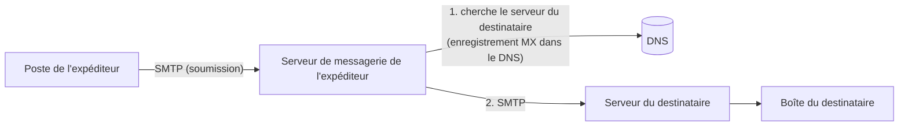

# Cours – Messagerie et DNS : usurpation et protection

*BTS SIO SISR 2e année – Bloc 3 – S09*

> Un mot ou un sigle inconnu ? Passe la souris dessus, ou ouvre le [glossaire](../../ressources/glossaire.md).

La messagerie est la porte d'entrée la plus utilisée par les attaquants (hameçonnage, fraude au président : séance S01). Et son fonctionnement repose sur le **DNS**, l'annuaire d'Internet. Cette séance traite deux questions liées : **comment empêcher qu'on envoie des messages en se faisant passer pour ton organisation**, et **comment protéger le DNS** dont tout dépend.

> [!NOTE]
> **B3.2 : l'identité numérique de l'organisation.** Un nom de domaine, une adresse d'expéditeur, un site web : ce sont des éléments d'identité. Un attaquant qui les usurpe **parle au nom de l'organisation**. La protéger est une compétence du bloc 3.

---

## 1. Le chemin d'un message



| Ports courants | Usage |
|---|---|
| **25** | Échange **entre serveurs** de messagerie |
| **587** (et 465) | **Soumission** d'un message par un utilisateur authentifié |
| **993** | Lecture par un client (IMAP chiffré) |

### Deux adresses d'expéditeur

Le protocole SMTP manipule **deux** expéditeurs distincts :

| | Où ? | Qui la voit ? |
|---|---|---|
| **Adresse d'enveloppe** (`MAIL FROM`, reprise dans l'en-tête `Return-Path`) | Dialogue entre serveurs | Les serveurs ; rarement l'utilisateur |
| **Adresse affichée** (en-tête `From:`) | Dans le message | **L'utilisateur** |

**SMTP ne vérifie ni l'une ni l'autre.** N'importe qui peut écrire `From: direction@votre-entreprise.fr`. Trois mécanismes, appuyés sur le DNS, permettent au destinataire de **vérifier**.

---

## 2. Les trois protections

### SPF : qui a le droit d'envoyer pour ce domaine ?

Le propriétaire du domaine publie, dans un enregistrement **TXT** du DNS, la **liste des serveurs autorisés** à envoyer en son nom. Le serveur destinataire compare l'adresse **de l'expéditeur réel** (celle de la connexion) à cette liste.

```text
lab.local.  IN TXT "v=spf1 ip4:192.0.2.25 -all"
```

| Élément | Sens |
|---|---|
| `v=spf1` | Version |
| `ip4:192.0.2.25` | Cette adresse est autorisée (`mx`, `a`, `include:` autorisent aussi des serveurs par nom) |
| `-all` | **Tout le reste est refusé** (échec) |
| `~all` | Tout le reste est **suspect** (échec « souple ») |
| `?all` | **Neutre** : aucune indication |

Limites : SPF vérifie l'**adresse d'enveloppe**, pas celle que l'utilisateur voit ; il **casse** quand un message est **transféré** (le serveur qui relaie n'est pas dans la liste) ; il est limité à **dix** consultations DNS.

### DKIM : le message est-il authentique et intact ?

Le serveur d'envoi **signe** certains en-têtes et le corps avec une **clé privée** ; la **clé publique** est publiée dans le DNS à un nom construit à partir d'un **sélecteur**.

```text
sel1._domainkey.lab.local.  IN TXT "v=DKIM1; k=rsa; p=<clé publique>"
```

Le message contient un en-tête `DKIM-Signature` (avec `d=` le domaine signataire, `s=` le sélecteur). Le destinataire interroge le DNS, **vérifie la signature**. Un message **modifié** après signature ne passe plus. DKIM **survit au transfert** (si le message n'est pas modifié), mais pas toujours à une liste de diffusion qui ajoute un pied de page.

### DMARC : que faire si ça ne passe pas ?

DMARC relie les deux précédents à l'adresse **visible** (`From:`) et dit **quoi faire en cas d'échec** :

```text
_dmarc.lab.local.  IN TXT "v=DMARC1; p=quarantine; rua=mailto:dmarc@lab.local"
```

| Élément | Sens |
|---|---|
| `p=none` | Ne rien faire, **seulement observer** |
| `p=quarantine` | Mettre en **spam** |
| `p=reject` | **Refuser** |
| `rua=` | Adresse où envoyer des **rapports agrégés** |
| **Alignement** | Le domaine du `From:` doit **correspondre** au domaine validé par SPF **ou** par DKIM |

Un message **réussit DMARC** si **au moins un** de SPF ou DKIM réussit **et est aligné** avec le domaine du `From:`.

> [!NOTE]
> **Mise en place progressive.** On publie d'abord `p=none` pour **observer** les rapports (quels serveurs envoient pour mon domaine ?), on **corrige** les oublis (outil d'envoi de newsletters, ticketing…), puis on passe à `quarantine`, enfin à `reject`. Passer directement à `reject` risque de **bloquer ses propres messages légitimes**.

---

## 3. Lire un message suspect

Dans un client de messagerie, « afficher l'original » donne les **en-têtes**. Repères :

| En-tête | À regarder |
|---|---|
| `From:` | Ce que voit l'utilisateur |
| `Return-Path:` | Adresse d'enveloppe : **différente** du `From:` ? |
| `Reply-To:` | Où partira la réponse : **différente** du `From:` ? |
| `Received:` | Chemin parcouru : à lire **de bas en haut** (le plus ancien est en bas) |
| `Authentication-Results:` | Verdict de **SPF, DKIM, DMARC** posé par **votre** serveur |
| `Message-ID:` | Domaine d'origine du message |

Un message qui **échoue** SPF, n'a **pas** de DKIM, **échoue** DMARC, avec un `Reply-To` vers une autre adresse : c'est une **usurpation**. Le contraire n'est pas une garantie : un message qui **passe** tout peut venir d'un domaine **proche** (`entrepise.fr` pour `entreprise.fr`) ou d'un compte **légitime compromis**.

---

## 4. Le DNS : ce qui peut mal tourner

Le DNS traduit des **noms** en adresses et porte les enregistrements de sécurité (SPF, DKIM, DMARC). Compromettre le DNS, c'est **rediriger** tout le monde.

| Risque | Principe | Mesure |
|---|---|---|
| **Transfert de zone ouvert** | N'importe qui peut demander **toute la zone** : la liste de tous les noms et adresses du domaine | Autoriser les transferts **seulement** aux serveurs secondaires |
| **Divulgation de version** | Le serveur annonce son logiciel et sa version | Masquer la version |
| **Résolveur ouvert** | Un serveur récursif qui répond à **tout le monde** sert à des attaques par amplification | Limiter la récursivité à son réseau |
| **Empoisonnement du cache** | Une fausse réponse est mémorisée par un résolveur | **DNSSEC**, ports et identifiants aléatoires |
| **Détournement chez le bureau d'enregistrement** | Un attaquant prend le contrôle du compte qui gère le nom de domaine | **Second facteur**, verrouillage du domaine, mots de passe forts |
| **Domaine expiré ou oublié** | Un attaquant rachète un nom dont l'organisation dépend | Suivi des échéances, renouvellement automatique |
| **Tunnel DNS** | Des données sont cachées dans des requêtes DNS pour sortir | Supervision, filtrage (S11, S12) |

### DNSSEC : signer les réponses

**DNSSEC** ajoute au DNS des **signatures** : un résolveur qui **valide** peut vérifier qu'un enregistrement **vient du propriétaire de la zone et n'a pas été modifié**.

| Notion | Sens |
|---|---|
| **RRSIG** | Signature d'un ensemble d'enregistrements |
| **DNSKEY** | Clés publiques de la zone (une clé de signature des clés, **KSK**, et une clé de signature de la zone, **ZSK**) |
| **DS** | « Empreinte » de la clé de la zone, publiée **dans la zone parente** : c'est le maillon de la **chaîne de confiance** (racine, puis domaine de premier niveau, puis le domaine) |

À retenir :

- DNSSEC garantit l'**intégrité et l'origine** des réponses, **pas leur confidentialité** (les requêtes restent lisibles ; le chiffrement des requêtes relève d'autres protocoles).
- Il **n'empêche pas** un détournement du compte chez le bureau d'enregistrement.
- Il demande de l'**exploitation** : les signatures **expirent** et doivent être renouvelées, les clés changées ; une erreur rend le domaine **injoignable** pour les résolveurs qui valident.

**Test flash.** Un attaquant envoie un message `From: paie@votre-entreprise.fr` à vos salariés. Votre domaine a SPF `-all` mais **pas de DMARC**. Qu'est-ce qui peut empêcher que les salariés le voient ?

<details markdown="1">
<summary>Voir la réponse</summary>

SPF vérifie l'**adresse d'enveloppe**, pas le `From:` affiché : l'attaquant peut mettre une enveloppe d'un domaine qu'il contrôle (qui passe son propre SPF) et usurper seulement le `From:`. **Sans DMARC**, rien ne relie le résultat à l'adresse visible, et le destinataire décide seul. C'est pourquoi on publie **DMARC** (avec une politique de refus), en plus de SPF et DKIM.

</details>
