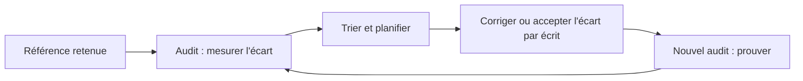

# Cours – Durcissement, conformité et gestion des correctifs

*BTS SIO SISR 2e année – Bloc 3 – S10*

> Un mot ou un sigle inconnu ? Passe la souris dessus, ou ouvre le [glossaire](../../ressources/glossaire.md).

En première année, tu as **appliqué** des mesures de durcissement à un serveur. Une organisation doit répondre à une autre question : **« cette machine est-elle conforme à ce qu'on a décidé, et comment le prouve-t-on ? »** Cette séance passe de **faire** à **mesurer, documenter et maintenir**.

---

## 1. Durcir : réduire la surface et fixer une référence

**Durcir** un système, c'est **réduire sa surface d'attaque** : supprimer ce qui est inutile, restreindre ce qui reste, et configurer au plus sûr.

| Famille | Exemples |
|---|---|
| **Services et logiciels** | Désinstaller les paquets inutiles ; désactiver les services non nécessaires ; fermer les ports inutiles (séance S01) |
| **Comptes et authentification** | Supprimer les comptes inutiles ; verrouiller les comptes génériques ; politique de mots de passe ; connexion d'administration par clé |
| **Droits et fichiers** | Droits stricts sur les fichiers sensibles ; `umask` restrictif pour les nouveaux fichiers ; sauvegarde des configurations |
| **Réseau** | Pare-feu local ; paramètres du noyau (pas de redirection ni de réponse aux redirections d'itinéraire inutiles) |
| **Journalisation** | Journaux activés, horodatés, envoyés ailleurs (séance S11) |
| **Mises à jour** | Correctifs de sécurité appliqués dans des délais fixés |

Pour ne pas durcir « au feeling », on part d'une **référence** (*baseline*) : une liste de réglages reconnus.

| Source de référence | Idée |
|---|---|
| **Guides de configuration de l'ANSSI** | Recommandations de configuration de systèmes et services |
| **Guides de durcissement du CIS** (par système) | Listes de réglages, avec niveaux d'exigence |
| **Politique interne** (PSSI, séance S03) | Ce que **l'organisation** a décidé de rendre obligatoire |

> [!NOTE]
> Une référence **s'adapte**. Désactiver un service que l'application utilise est une panne, pas du durcissement. Chaque **écart volontaire** est **documenté** avec sa justification et son responsable.

---

## 2. Mesurer la conformité

Comparer à la main des centaines de réglages est impossible : des **outils d'audit** le font.

| Outil | Usage |
|---|---|
| **Lynis** | Audit **local** d'un système Linux : tests, avertissements, suggestions, **indice** de durcissement |
| **OpenSCAP** | Évalue un système par rapport à un **profil de conformité** formalisé |
| **Scanneurs de vulnérabilités** | Cherchent des **failles connues** (séance S13) : autre question |

### Lire un rapport d'audit

| Élément | Sens |
|---|---|
| **Avertissement** (*warning*) | Un problème à traiter en priorité |
| **Suggestion** | Une amélioration possible ; **toutes** ne se valent pas |
| **Indice de durcissement** | Un **score** de synthèse |
| **Identifiant du test** (par exemple `AUTH-9328`) | Permet de retrouver le détail et de suivre le point dans le temps |

> [!WARNING]
> **Un indice n'est pas une certification, et 100 n'est pas l'objectif.** Un score augmente quand on traite beaucoup de petites suggestions, pas nécessairement les plus importantes. On **trie** : gravité (risques de la séance S02), effort, effet de bord, et on **justifie** ce qu'on ne fait pas. Un rapport d'audit non exploité est du bruit.

### La boucle de conformité

À l'échelle de dizaines de machines, on **n'applique pas à la main** : on décrit la configuration cible dans un outil d'automatisation (par exemple **Ansible**, vu au bloc 2), qui **applique** et **remet en conformité**. Le rapport d'audit devient un **contrôle régulier**.

---

## 3. La gestion des correctifs

Une très grande partie des intrusions exploitent des failles **dont le correctif existe déjà**. Appliquer les correctifs est donc une mesure **de base**… et la plus difficile à tenir dans la durée, parce qu'un correctif peut **casser** quelque chose.

### Un processus, pas un geste

| Étape | Question |
|---|---|
| **1. Inventorier** | Quels systèmes, quels logiciels, quelles versions ? (On ne corrige pas ce qu'on ne connaît pas.) |
| **2. Se tenir informé** | D'où viennent les alertes ? (éditeur, liste de l'ANSSI / CERT-FR, flux de la distribution) |
| **3. Évaluer** | La faille concerne-t-elle **mes** systèmes ? Est-elle **exposée** à Internet ? Est-elle **exploitée** ? (séance S13) |
| **4. Tester** | Sur une machine **pilote** ou un environnement de test |
| **5. Déployer** | Par **vagues**, hors heures sensibles, avec **sauvegarde ou instantané** préalable |
| **6. Vérifier** | Le correctif est-il bien appliqué ? Le service fonctionne-t-il ? |
| **7. Tracer** | Qui a appliqué quoi, quand ; exceptions et échéances |
| **8. Prévoir le retour arrière** | Comment revenir à l'état précédent ? |

### Délais selon la gravité

Les délais d'application se **fixent par politique** (par exemple « sous quelques jours pour une faille critique exposée, sous quelques semaines pour les autres ») : **à décider avec la direction**, pas à emprunter à un chiffre générique. L'important est qu'ils soient **écrits, suivis et tenus**.

### Cas particuliers

| Cas | Traitement |
|---|---|
| **Logiciel en fin de support** | Plus de correctifs : **migrer**, ou **isoler** (réseau séparé, séance S05) en attendant ; c'est le cas des PC sous Windows 7 de l'Atelier Verdier |
| **Système qui ne peut pas être arrêté** | Fenêtre de maintenance planifiée ; redondance (bloc 2) |
| **Mises à jour de sécurité automatiques** | Possibles sur les systèmes simples (outil de mises à jour automatiques de la distribution), avec **surveillance** du résultat ; plus risqué sur un serveur d'application critique |
| **Noyau** | Un redémarrage est souvent nécessaire pour que le correctif soit **réellement actif** |

**Test flash.** Un audit donne un indice de 72 après correction, contre 58 avant. Le responsable dit « objectif atteint ». Que lui réponds-tu ?

Voir la réponse

L'indice est un **indicateur**, pas un objectif : il faut regarder **quelles** suggestions ont été traitées (les plus graves d'abord ?), lesquelles restent, et si les **écarts acceptés** sont **justifiés par écrit**. Un score peut monter en traitant beaucoup de détails sans corriger l'exposition principale (par exemple une version non supportée).

