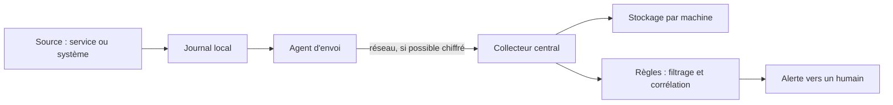

# Cours – Journaux centralisés et supervision de sécurité

*BTS SIO SISR 2e année – Bloc 3 – S11*

> Un mot ou un sigle inconnu ? Passe la souris dessus, ou ouvre le [glossaire](../../ressources/glossaire.md).

Une attaque laisse des **traces**, mais réparties : un échec de connexion sur le serveur de fichiers, un autre sur le serveur web, un compte créé sur l'annuaire. Lues machine par machine, ces traces passent inaperçues. Lues **ensemble**, elles racontent une histoire. Cette séance apprend à **rassembler**, **dater**, **croiser** et **conserver** les journaux.

---

## 1. Pourquoi centraliser

| Problème avec des journaux locaux | Ce que la centralisation apporte |
|---|---|
| Il faut se connecter à **chaque** machine | Un **seul** endroit de recherche |
| L'attaquant qui prend la main peut **effacer** les journaux de la machine | Une **copie** déjà partie ailleurs (preuve, séance S15) |
| Les journaux **tournent** et disparaissent vite | **Conservation** décidée et maîtrisée |
| Impossible de **croiser** deux machines | **Corrélation** entre sources |
| Machine **éteinte ou chiffrée** : journaux inaccessibles | Les événements d'**avant** l'incident sont à l'abri |

> [!NOTE]
> La centralisation ne protège que ce qui est **envoyé**. Un attaquant qui **coupe l'envoi** avant d'agir garde ses traces locales hors de portée : surveiller **l'absence** de journaux d'une machine fait partie de la supervision.

---

## 2. Que journaliser

| Source | Événements utiles |
|---|---|
| **Authentification** | Succès et échecs de connexion, changements de mot de passe, élévation de privilèges (`sudo`) |
| **Annuaire** | Création de comptes, ajouts aux groupes sensibles (séance S06) |
| **Pare-feu et sondes** | Flux refusés (séance S05), alertes (séance S12) |
| **Services exposés** | Journaux d'accès et d'erreurs du serveur web et du reverse proxy (séance S08) |
| **Systèmes** | Démarrages, arrêts, installations, arrêt du service de journalisation |

Pour chaque événement, on veut répondre à **qui, quoi, quand, d'où** (et le résultat). Un journal qui n'indique pas **l'heure fiable** ou **l'origine** vaut peu.

> [!WARNING]
> Les journaux contiennent des **données personnelles** (identifiants, adresses IP, parfois des actions d'utilisateurs). Ils relèvent du RGPD (séance S04) : **finalité**, **accès restreint**, **durée limitée**, information des personnes. Ne **jamais** y écrire de mots de passe.

---

## 3. Le trajet d'un événement

| Choix | À savoir |
|---|---|
| **Protocole d'envoi** | **UDP** : simple mais des messages peuvent se perdre sans que personne le sache. **TCP** : accusé de réception de transport, reprise après coupure. Pour un événement de sécurité, on choisit **TCP** |
| **Chiffrement** | Les journaux circulent en clair par défaut : sur un réseau non maîtrisé, on ajoute **TLS** (séance S08 pour le principe) |
| **File d'attente** | Si le collecteur est injoignable, l'agent **garde** les messages et les renvoie. Une file **en mémoire** est perdue si l'agent redémarre : une file **sur disque** est plus sûre |
| **Format** | Le **syslog** est le format classique (priorité, date, machine, programme, message). Les journaux structurés (JSON) se filtrent plus facilement |

---

## 4. Dater : la synchronisation du temps

Pour **reconstituer** une chronologie (séance S15), toutes les machines doivent avoir **la même heure**.

| Règle | Pourquoi |
|---|---|
| Un service de **synchronisation** (NTP, par exemple `chrony`) sur **toutes** les machines, avec une source commune | Écart de quelques secondes = événements dans le mauvais ordre |
| Horodatage avec **fuseau** (UTC de préférence sur les serveurs) | Évite les confusions d'heure d'été |
| **Surveiller** la dérive | Une machine qui dérive est une source de preuves douteuses |

---

## 5. Corréler : transformer des lignes en alertes

Un événement isolé n'a souvent aucune signification. La **corrélation** relie des événements :

| Règle | Exemple | Ce qu'elle détecte |
|---|---|---|
| **Seuil** | 5 échecs de connexion depuis la même adresse | Essai de mots de passe |
| **Multi-machines** | La même adresse échoue sur **plusieurs** serveurs | Balayage d'une plage de machines |
| **Séquence** | Plusieurs échecs, **puis** un succès, **puis** création d'un compte | Intrusion réussie |
| **Absence** | Plus aucun journal de la machine X depuis 10 minutes | Panne, ou coupure volontaire |
| **Horaire** | Connexion d'administration à 3 h du matin | Usage inhabituel |

Les outils complets de supervision de sécurité (SIEM, par exemple **Wazuh**) font cela à grande échelle, avec tableaux de bord, règles prêtes à l'emploi et recherche. Le **principe** reste celui du TP : collecter, normaliser, comparer à des règles, alerter.

> [!WARNING]
> **Une alerte n'a de valeur que si quelqu'un la traite.** Trop d'alertes sans importance et l'équipe n'en lit plus aucune (séance S12). Chaque règle a un **seuil** réglé, un **responsable** et une **procédure** de réaction.

---

## 6. Conserver : combien de temps ?

La durée **n'est pas libre** : elle se justifie par la **finalité** et le cadre juridique.

| Repère | Contenu |
|---|---|
| **Recommandation de la CNIL sur la journalisation** (délibération n° 2021-122 du 14 octobre 2021) | Pour la journalisation courante : conservation **entre six mois et un an**. Au-delà, jusqu'à trois ans dans les cas les plus courants, si le besoin est **démontré et documenté** |
| **Obligations légales particulières** | Certains acteurs (par exemple les hébergeurs et fournisseurs d'accès) ont des durées imposées : à vérifier avec un juriste pour chaque organisation |
| **Besoin de sécurité** | Une intrusion est souvent découverte **des mois** après : une durée trop courte rend l'enquête impossible |

On conserve **assez** pour enquêter, **pas plus** que justifié, et on **supprime** à l'échéance.

| Outil | Rôle |
|---|---|
| **Rotation** (`logrotate`) | Découpe les fichiers, compresse, supprime après N cycles |
| **Droits** | Lecture limitée aux personnes habilitées ; écriture réservée au service |
| **Intégrité** | Copie vers un support en **écriture unique**, ou signature (pour la valeur de preuve) |

**Test flash.** Un administrateur dit : « on garde tout cinq ans, au cas où ». Que lui réponds-tu ?

Voir la réponse

La durée doit se **justifier** par une finalité (RGPD, séance S04). Au-delà de ce que la recommandation de la CNIL admet pour la journalisation courante, il faut **documenter le besoin** ; « au cas où » n'est pas une justification. À l'inverse, deux semaines serait trop court pour enquêter sur une intrusion découverte tardivement.

