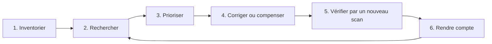

# Cours – Gestion des vulnérabilités : de la découverte à la correction

*BTS SIO SISR 2e année – Bloc 3 – S13*

> Un mot ou un sigle inconnu ? Passe la souris dessus, ou ouvre le [glossaire](../../ressources/glossaire.md).

Un scanneur de vulnérabilités sait produire un rapport de **quatre cents lignes** en une nuit. Le métier, c'est **ce qu'on en fait** : décider laquelle corriger en premier, avec quels moyens, et **prouver** que c'est fait. Cette séance prolonge l'audit de conformité de la séance S10 (« est-ce conforme à ce qu'on a décidé ? ») par une autre question : « **qu'est-ce qui est faible, et qui peut s'en servir ?** »

---

## 1. Les mots à ne pas confondre

| Terme | Sens | Exemple |
|---|---|---|
| **Vulnérabilité** | Faiblesse dans un logiciel, un matériel ou une configuration | Une version d'un logiciel qui accepte une requête mal formée |
| **Correctif** | Mise à jour ou réglage qui supprime la faiblesse | Version corrigée ; désactivation d'une option |
| **Exposition** | Qui peut **atteindre** la faiblesse | Machine joignable depuis Internet, ou seulement depuis un réseau interne |
| **Exploit** | Code ou méthode qui **tire parti** de la faiblesse | Un programme publié qui réussit l'attaque |
| **Exploitation** | L'exploit est **utilisé**, en vrai, par des attaquants | Alerte d'une autorité : « activement exploitée » |

Une vulnérabilité **non exposée** et **sans exploit connu** n'a pas le même niveau d'urgence qu'une vulnérabilité **exposée** et **exploitée**, même si leur note est identique : c'est tout l'enjeu de la priorisation.

Deux origines différentes :

| | Faille de **logiciel** | Faille de **configuration** |
|---|---|---|
| Cause | Erreur de conception ou de programmation | Réglage laissé par défaut ou mal choisi |
| Remède | Correctif de l'éditeur | **Réglage** (souvent gratuit et immédiat) |
| Exemples | Exécution de code à distance | Identifiants par défaut ; liste de fichiers ouverte ; sauvegarde laissée en accès public |

---

## 2. Identifier et noter : CVE et CVSS

| Sigle | Rôle |
|---|---|
| **CVE** | **Identifiant** public et unique d'une vulnérabilité (forme `CVE-année-numéro`) |
| **CWE** | **Famille** de faiblesse (par exemple l'injection) |
| **CVSS** | **Note de gravité** de 0 à 10, calculée à partir de critères |
| **NVD** | Base publique qui rassemble les fiches CVE et leurs notes |

### Lire un vecteur CVSS (version 3.1)

`AV:N/AC:L/PR:N/UI:N/S:U/C:H/I:H/A:H`

| Critère | Valeurs | Question |
|---|---|---|
| **AV** (vecteur d'attaque) | N réseau, A réseau voisin, L local, P physique | **D'où** peut-on attaquer ? |
| **AC** (complexité) | L faible, H élevée | L'attaque réussit-elle **à coup sûr** ? |
| **PR** (privilèges requis) | N aucun, L faibles, H élevés | Faut-il **déjà** un compte ? |
| **UI** (interaction) | N aucune, R requise | Faut-il qu'un utilisateur **clique** ? |
| **S** (portée) | U inchangée, C changée | L'attaque **déborde**-t-elle sur d'autres composants ? |
| **C / I / A** | N aucun, L faible, H élevé | Effet sur la **confidentialité**, l'**intégrité**, la **disponibilité** |

Les notes se classent ainsi : **0** aucune ; **0,1 à 3,9** faible ; **4,0 à 6,9** moyenne ; **7,0 à 8,9** élevée ; **9,0 à 10** critique.

> [!NOTE]
> Une version **4.0** du CVSS existe aussi et se rencontre de plus en plus ; ce cours utilise la **3.1**, encore très présente dans les rapports. Le calcul diffère : vérifie la version affichée dans un rapport avant de comparer deux notes.

### Ce que la note ne dit pas

| Limite | Conséquence |
|---|---|
| La note de base mesure la **gravité technique**, **pas le risque pour toi** | Une faille critique sur un logiciel que tu n'utilises pas ne te concerne pas |
| Elle ignore l'**exposition** de ta machine | La même faille est urgente sur un serveur public, moins sur un poste isolé |
| Elle ignore l'**exploitation réelle** | Une faille moyenne **activement exploitée** passe avant une faille critique sans exploit connu |
| Elle ignore la **valeur de l'actif** (séance S02) | Une faille « moyenne » sur la sauvegarde peut être plus grave qu'une faille « élevée » sur un poste de test |
| Beaucoup de rapports comptent **les failles de configuration** comme des CVE | Mais leur note est **estimée**, pas officielle |

Des sources aident à savoir **ce qui est exploité** : le **catalogue des vulnérabilités connues comme exploitées** (KEV) de l'agence américaine CISA, les **alertes du CERT-FR**, et des **scores de probabilité d'exploitation** comme l'EPSS. À consulter au moment de prioriser ; leurs données **changent** et ne s'apprennent pas par cœur.

---

## 3. Le cycle de gestion des vulnérabilités

| Étape | Points clés |
|---|---|
| **Inventorier** | On ne scanne que ce qu'on connaît : sans inventaire (séance S10), des machines échappent au cycle |
| **Rechercher** | Scanner **régulièrement**, pas une fois l'an ; surveiller les **alertes** (éditeurs, CERT-FR) entre deux scans |
| **Prioriser** | Note **+** exposition **+** exploitation **+** valeur de l'actif **+** disponibilité d'un correctif |
| **Corriger ou compenser** | Correctif ; sinon **mesure compensatoire** (isoler, filtrer, désactiver le service) |
| **Vérifier** | Un **nouveau scan** prouve que la faille a disparu : « corrigé » sans preuve n'est qu'une déclaration |
| **Rendre compte** | Indicateurs lisibles par la direction : nombre de failles ouvertes par priorité, **délai moyen de correction**, exceptions en cours |

### Que faire quand il n'y a pas de correctif ?

| Situation | Réponse |
|---|---|
| Logiciel en **fin de support** (les PC de l'Atelier Verdier sous Windows 7) | **Migrer** ; en attendant **isoler** dans une zone dédiée aux flux minimaux (séance S05) |
| Correctif pas encore publié | **Contourner** : désactiver le composant, filtrer l'accès, surveiller (séance S12) |
| Correctif qui **casse** l'application | Tester, négocier une fenêtre ; **accepter le risque par écrit** avec date de revue (séance S10) |

---

## 4. Les outils : ce qu'ils font et ne font pas

| Outil | Fait | Ne fait pas |
|---|---|---|
| **Nmap** | Découvre les machines et services ouverts, **identifie les versions** | Ne note pas la gravité à lui seul |
| **Scripts de Nmap** (`--script`) | Vérifie des faiblesses précises (listes de fichiers, algorithmes faibles…) | Couverture limitée aux scripts disponibles |
| **Nikto** | Cherche des faiblesses **web** courantes (fichiers oubliés, en-têtes absents) | Ne comprend pas votre application |
| **Scanneurs complets** (par exemple OpenVAS / Greenbone, Nessus) | Comparent versions et configurations à une **base de failles** mise à jour | Demandent une **installation lourde** et des mises à jour de base |
| **Scan authentifié** (avec un compte sur la machine) | Voit les **paquets installés** et les configurations : bien plus complet | Demande un compte : à encadrer |

> [!WARNING]
> **Un scan peut perturber un service** (requêtes inhabituelles, saturation d'un équipement fragile) et **ressemble à une attaque**. On ne scanne **que** avec une **autorisation écrite** qui précise le **périmètre** (machines, adresses), les **dates et heures**, les **outils**, et un **contact** en cas d'incident (séances S04 et S14). Un scan sans autorisation d'une machine qui n'est pas la tienne est une infraction, même « pour voir ».

Les résultats d'un scanneur contiennent des **faux positifs** (faille signalée qui n'existe pas : version détectée à tort) et des **faux négatifs** (faille présente mais non vue). On **vérifie à la main** les points qui comptent avant de réveiller quelqu'un.

**Test flash.** Un rapport affiche 240 failles « critiques ou élevées ». Le responsable demande de tout corriger avant la fin du mois. Que réponds-tu ?

Voir la réponse

On **priorise** : exposition, exploitation connue, valeur de l'actif, disponibilité d'un correctif. Les premières corrections vont à ce qui est **exposé et exploité** ou qui touche un actif **critique** (par exemple la sauvegarde), puis aux corrections **rapides et gratuites** (réglages). Le reste est planifié avec des **délais** selon la priorité, et les failles qu'on ne peut pas corriger reçoivent une **mesure compensatoire** ou une **acceptation de risque** écrite. « Tout corriger » sans méthode épuise l'équipe et ne réduit pas le risque plus vite.

