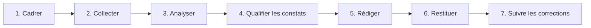

# Cours – Audit de sécurité : cadre, démarche et rapport

*BTS SIO SISR 2e année – Bloc 3 – S14*

> Un mot ou un sigle inconnu ? Passe la souris dessus, ou ouvre le [glossaire](../../ressources/glossaire.md).

Un audit de sécurité n'est pas « chercher des failles pour voir » : c'est une **mission encadrée**, qui répond à une question posée par l'organisation, et dont le **livrable** est un rapport qu'un dirigeant peut utiliser. Cette séance traite le **cadre**, la **démarche** et le **rapport**. Elle s'appuie sur ce que tu sais déjà faire (analyse de risques S02, scan S13) et ne demande **aucune attaque**.

---

## 1. Les types d'audit

| Type | Question posée | Méthode |
|---|---|---|
| **Organisationnel** | Les règles, rôles et procédures existent-ils et sont-ils appliqués ? | Documents, entretiens |
| **De configuration** | Les systèmes sont-ils réglés selon la référence ? (S10) | Revue de configuration, outils d'audit |
| **D'architecture** | Le découpage réseau, les flux, les accès sont-ils cohérents ? (S05) | Schémas, règles de filtrage |
| **De vulnérabilités** | Quelles failles connues sont présentes ? (S13) | Scans |
| **Test d'intrusion** | Un attaquant réaliste peut-il atteindre un objectif précis ? | Tentatives **encadrées** d'exploitation |
| **D'ingénierie sociale** | Le personnel résiste-t-il à la manipulation ? | Campagnes de sensibilisation encadrées |

Un **test d'intrusion** est l'audit le plus intrusif : il se déroule sous un cadre contractuel très précis, par des professionnels, et **jamais** « pour s'entraîner » sur un système qui n'est pas dédié à cet usage. En France, l'ANSSI qualifie des prestataires d'audit (les **PASSI**) : leur existence rappelle que le métier est encadré. Les détails (périmètre, exigences, liste à jour) sont à vérifier auprès de l'ANSSI.

---

## 2. Le cadre : avant la première commande

### L'autorisation écrite

Sans autorisation, un accès ou une tentative d'accès à un système est **pénalement répréhensible**, même sans intention de nuire (séance S04, atteintes aux systèmes de traitement automatisé de données). L'autorisation doit venir d'une personne **qui a le pouvoir** de la donner.

| Élément | Pourquoi |
|---|---|
| **Qui signe** | Le dirigeant ou son délégué **habilité** ; pas la première personne rencontrée |
| **Périmètre** | Liste **précise** : adresses, applications, locaux, comptes. Ce qui n'est pas écrit est **hors périmètre** |
| **Les tiers** | Un système **hébergé chez un prestataire** (ERP en ligne, messagerie) appartient au prestataire : **son** accord est nécessaire |
| **Dates et horaires** | Évite les confusions avec une vraie attaque et protège la production |
| **Ce qui est interdit** | Saturer un service, détruire ou copier des données, tromper des tiers… |
| **Contact d'urgence** | Pour **arrêter** immédiatement si un incident survient |
| **Confidentialité** | Les résultats et les données vues restent confidentiels ; sort des preuves à la fin |
| **Responsabilités** | Que se passe-t-il si un service tombe ? Qui est assuré ? |

### Les règles d'engagement pendant la mission

- On reste **dans le périmètre**, même si un système voisin est visiblement accessible.
- On **s'arrête et on prévient** dès qu'on trouve un **danger immédiat** (donnée sensible exposée sur Internet, intrusion déjà en cours par un tiers) : cela se signale **tout de suite**, pas dans le rapport final.
- On **minimise** les données personnelles vues : on prouve l'accès par une **capture limitée**, pas par une copie du contenu (RGPD, S04).
- On **trace** ses propres actions (qui, quoi, quand) : elles se distinguent ainsi d'une vraie attaque.

---

## 3. La démarche

| Étape | Contenu |
|---|---|
| **Cadrer** | Objectif, périmètre, méthode, calendrier, autorisation signée |
| **Collecter** | Documents, entretiens, configurations, résultats d'outils |
| **Analyser** | Comparer **ce qui est** à **ce qui devrait être** (référence : politique de sécurité, guides) |
| **Qualifier** | Pour chaque constat : **preuve**, **gravité**, **facilité**, **priorité** |
| **Rédiger** | Un rapport **pour deux lecteurs** : la direction et les techniciens |
| **Restituer** | Une présentation orale, un échange, des décisions |
| **Suivre** | Un nouveau contrôle prouve que les corrections ont eu lieu (S13) |

### La qualité d'un constat

Un bon constat est : **factuel** (ce qui est observé, pas ce qui est supposé), **prouvé** (extrait, capture, mesure), **daté**, **reproductible**, **mesuré** (gravité, effet pour l'organisation), **relié** à une exigence (référentiel, politique).

| Niveau de preuve | Exemple |
|---|---|
| **Solide** | Capture de la configuration qui montre le port exposé |
| **Partielle** | Le responsable dit que « les sauvegardes fonctionnent » : à vérifier |
| **Insuffisante** | « Il paraît qu'il n'y a pas de journaux » : **ne se met pas dans un rapport** tant que c'est non vérifié |

> [!WARNING]
> Un constat **sans preuve** discrédite tout le rapport. Mieux vaut un constat **à confirmer** (indiqué comme tel) qu'une affirmation fausse.

---

## 4. Le rapport

| Partie | Lecteur | Contenu |
|---|---|---|
| **Résumé managérial** | Direction | Une page : le **bilan**, les **trois risques majeurs**, les **actions prioritaires**, sans jargon |
| **Contexte et méthode** | Tous | Mission, périmètre, dates, limites (ce qui n'a pas été regardé) |
| **Constats** | Techniciens | Une **fiche par constat** |
| **Plan d'action** | Direction et techniciens | Actions classées par **priorité**, responsable proposé, délai |
| **Annexes** | Techniciens | Preuves détaillées, sorties d'outils |

### Une fiche de constat

| Champ | Contenu |
|---|---|
| Identifiant et titre | `C03 – Sauvegarde jamais testée` |
| Description | Ce qui a été observé |
| Preuve | Référence à l'annexe |
| Risque | Ce que cela permet, pour **quelle valeur métier** (S02) |
| Gravité et facilité | Échelles de 1 à 4 |
| Recommandation | Action **précise** et **réaliste** |
| Priorité | Selon une règle écrite (S13) |

Une recommandation utile est **précise** (« désactiver la redirection du port 3389 sur la box, ouvrir un accès par VPN ») et non générique (« améliorer la sécurité »).

### La restitution orale

Cinq minutes pour un dirigeant : **ce qui va bien** (commencer par là, c'est vrai et cela se reçoit mieux), **les trois risques**, **les décisions à prendre aujourd'hui**, **ce que cela coûte** (temps, argent), **quand on revérifie**.

---

## 5. Ce qu'on fait des découvertes imprévues

| Situation | Réflexe |
|---|---|
| **Danger immédiat** (accès ouvert, intrusion en cours) | **Prévenir tout de suite** le contact d'urgence, par un canal sûr |
| **Données personnelles** sensibles découvertes | **Ne pas les copier**, minimiser, signaler dans le rapport sans les reproduire |
| **Activité manifestement illicite** (hors sujet de la mission) | S'arrêter, prévenir le donneur d'ordre, se faire conseiller juridiquement |
| **Système hors périmètre** accessible | **Ne pas y toucher** ; le signaler |

**Test flash.** On te demande « un test d'intrusion de l'entreprise » par courriel, sans plus de précisions. Que fais-tu ?

Voir la réponse

**Rien de technique.** Tu demandes un cadrage écrit : objectif, périmètre précis, tiers concernés (leur accord), dates, interdits, contact d'urgence, signataire habilité. Sans cela, ni test ni scan : la demande, aussi bienveillante soit-elle, ne vaut pas autorisation.

