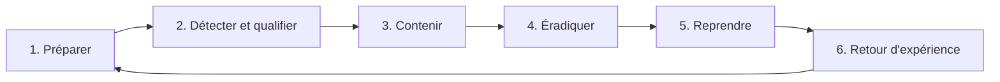

# Cours – Réponse à incident et investigation

*BTS SIO SISR 2e année – Bloc 3 – S15*

> Un mot ou un sigle inconnu ? Passe la souris dessus, ou ouvre le [glossaire](../../ressources/glossaire.md).

Lundi, 7 h 45 : un salarié ne peut plus ouvrir ses plans, un message réclame une rançon. Les **premières heures** décident de la suite : ce qu'on **perd**, ce qu'on **prouve**, ce qu'on **doit déclarer**. Cette séance apprend à réagir **dans l'ordre**, à **conserver les preuves** et à **reconstituer** ce qui s'est passé à partir de journaux.

---

## 1. Les phases de la réponse à incident

| Phase | Question | Exemples |
|---|---|---|
| **Préparer** | Sait-on **qui fait quoi** avant l'incident ? | Liste de contacts, procédures, sauvegardes **testées**, journaux centralisés (S11) |
| **Détecter et qualifier** | Est-ce un incident ? De quelle gravité ? | Alerte (S12), signalement d'un salarié ; **incident** ou **simple événement** ? |
| **Contenir** | Comment **arrêter l'extension** ? | Isoler la machine du réseau, couper un compte, bloquer une adresse |
| **Éradiquer** | Comment **supprimer** la cause ? | Retirer le compte créé par l'attaquant, fermer l'accès d'entrée, reconstruire les machines |
| **Reprendre** | Comment **revenir** à un fonctionnement sûr ? | Restaurer depuis une sauvegarde **saine**, surveillance renforcée |
| **Retour d'expérience** | Qu'**apprend-on** ? | Chronologie, causes, plan d'amélioration |

> [!NOTE]
> **Contenir avant d'éradiquer.** Réinstaller une machine tout de suite efface les preuves et ne règle rien si l'attaquant a encore un accès ailleurs. On **isole**, on **comprend le périmètre**, puis on **nettoie**.

### Le premier quart d'heure

| Geste | Pourquoi |
|---|---|
| **Noter l'heure** et ce qui est observé (photographier l'écran) | La première trace est souvent la plus précieuse |
| **Isoler du réseau** la machine touchée (câble ou Wi-Fi coupé) | Empêche l'extension |
| **Ne pas effacer, ne pas « nettoyer »** | Les traces disparaîtraient |
| **Alerter** la chaîne définie (responsable, direction, prestataire) | Évite de décider seul |
| **Ne pas utiliser** la machine ni les comptes touchés | Évite d'altérer les preuves |
| **Préserver** les journaux et les sauvegardes encore saines | Condition de la reprise |
| **Changer** les mots de passe des comptes concernés, **depuis une machine saine** | L'attaquant a peut-être déjà ces mots de passe |

**Éteindre ou laisser allumé ?** Un arrêt brutal fait **perdre la mémoire** (des traces utiles, parfois la clé de chiffrement) ; laisser allumé **peut laisser le chiffrement continuer**. Le choix dépend de la situation et se fait **avec** la personne compétente, de préférence selon la procédure préparée. Le guide de l'ANSSI sur les rançongiciels est la référence à consulter (à vérifier dans sa version à jour).

---

## 2. Les preuves

### L'ordre de volatilité

On collecte d'abord ce qui **disparaît le plus vite** (principe décrit par la note **RFC 3227**) :

| Ordre | Élément | Durée de vie |
|---|---|---|
| 1 | Mémoire, processus en cours, connexions réseau | Jusqu'à l'arrêt |
| 2 | Fichiers temporaires | Court |
| 3 | Disque | Persistant, mais **modifiable** |
| 4 | **Journaux distants** (collecteur, pare-feu, NAS) | Selon la conservation (S11) |
| 5 | Sauvegardes, archives | Long |

### La chaîne de preuve

Une preuve n'a de valeur que si l'on peut **démontrer qu'elle n'a pas été modifiée** :

| Règle | Mise en œuvre |
|---|---|
| **Travailler sur des copies** | L'original reste intact, rangé |
| **Empreinte** | Calculer une **empreinte** (hachage, par exemple SHA-256) de l'original **avant** et la **conserver séparément** : si le fichier change d'un octet, l'empreinte change |
| **Traçabilité** | Qui a pris la preuve, quand, où elle est rangée, qui y a accédé |
| **Horodatage fiable** | Heure de la machine et **décalage** noté (S11) |
| **Minimisation** | Ne copier que ce qui est nécessaire (données personnelles, RGPD, S04) |

> [!WARNING]
> Les **journaux d'une machine compromise** peuvent avoir été **modifiés** par l'attaquant. D'où l'intérêt des copies **distantes** (S11) et du **recoupement** de plusieurs sources : une trace absente d'un journal peut apparaître dans un autre.

---

## 3. Reconstituer la chronologie

Une chronologie est un tableau **daté** qui rassemble les événements de **toutes** les sources (S11) et distingue ce qui est **prouvé** de ce qui est **supposé**.

| Heure | Source | Événement | Interprétation | Niveau de certitude |
|---|---|---|---|---|

On cherche ensuite :

| Question | Réponse attendue |
|---|---|
| **Entrée** | Par où l'attaquant est-il entré ? (accès distant, message piégé, faille) |
| **Progression** | Quels comptes, quelles machines ? |
| **Actions** | Création de comptes, arrêt de protections, suppression de sauvegardes |
| **Données** | Y a-t-il eu **vol** (flux sortants inhabituels) avant le chiffrement ? |
| **Périmètre** | Qu'est-ce qui est **touché**, **menacé**, **sain** ? |
| **Fin** | L'attaquant est-il encore présent ? |

Dans les attaques par rançongiciel, un **vol de données avant le chiffrement** est courant (« double extorsion », S01) : retrouver les fichiers chiffrés **ne suffit pas** à clore l'incident.

---

## 4. Les obligations et la communication

| Sujet | À savoir (renvoie à la séance S04) |
|---|---|
| **Violation de données personnelles** | Notification à la **CNIL** dans les **72 heures** après en avoir pris connaissance, **si** elle présente un risque pour les personnes ; information des personnes concernées si le risque est **élevé** |
| **Plainte** | Dépôt auprès des autorités ; les preuves conservées servent |
| **Assurance** | Contrat cyber éventuel : délai de déclaration à respecter |
| **Assistance** | Dispositif national d'assistance aux victimes (cybermalveillance.gouv.fr) ; ANSSI selon les cas |
| **Clients, partenaires** | Information **maîtrisée** si leurs données ou leurs travaux sont touchés |
| **Rançon** | Les autorités recommandent de **ne pas payer** : payer ne garantit ni la restitution ni l'absence de publication, et finance les attaquants |

### Communiquer en crise

| Public | Message |
|---|---|
| **Direction** | **Faits** connus, **hypothèses**, décisions à prendre, **prochain point** à heure fixe |
| **Salariés** | Quoi faire et **ne pas faire** (ne pas éteindre, ne pas brancher de clé, ne pas répondre aux demandes de l'attaquant) |
| **Clients, autorités** | Communication **validée** par la direction, sans spéculation |

On ne communique **jamais** de supposition comme un fait.

**Test flash.** Le prestataire propose : « on réinstalle tout ce soir, ce sera réglé demain ». Que réponds-tu ?

Voir la réponse

**Pas avant d'avoir contenu et conservé.** Réinstaller efface les **preuves** (entrée, périmètre, vol éventuel) et **ne garantit pas** que l'attaquant n'a plus d'accès ailleurs ni que la sauvegarde de reprise est saine. On isole, on **copie** ce qui doit l'être (avec empreintes), on **comprend** le périmètre, puis on reconstruit. Les délais de **notification** continuent de courir pendant ce temps.

