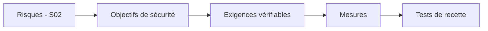

# Cours – La sécurité dans un projet d'infrastructure

*BTS SIO SISR 2e année – Bloc 3 – S17*

> Un mot ou un sigle inconnu ? Passe la souris dessus, ou ouvre le [glossaire](../../ressources/glossaire.md).

Tout ce que tu as vu depuis S01 se corrige **après coup** : durcir, filtrer, journaliser, sauvegarder. Cette séance renverse l'ordre : **intégrer la sécurité au projet dès le cahier des charges**, la chiffrer, la faire **tester à la livraison** et la **maintenir** ensuite. C'est aussi ce qu'on attend dans l'épreuve E7 (proposer, justifier, chiffrer). Le cahier des charges lui-même est vu au bloc 2 : ici on n'en refait pas le cours, on y **ajoute la sécurité**.

---

## 1. Pourquoi dès la conception

| Intégrer la sécurité… | Conséquence |
|---|---|
| **Au départ** | Une exigence coûte peu : elle s'ajoute au plan |
| **À la livraison** | Il faut **refaire** : coût élevé, délai, parfois impossible (architecture figée) |
| **Après un incident** | On paie l'incident **et** la correction |

Deux principes, issus du RGPD (séance S04) et de la pratique :

| Principe | Sens |
|---|---|
| **Protection des données dès la conception et par défaut** | Le système collecte **le minimum**, avec les réglages les **plus protecteurs** par défaut |
| **Défense en profondeur** | Plusieurs barrières successives ; la chute d'une ne suffit pas (S02, S05) |

---

## 2. De l'analyse de risques aux exigences

Le chemin :

| Étape | Exemple |
|---|---|
| **Risque** | Un attaquant accède au site d'administration depuis Internet |
| **Objectif** | Seules les personnes habilitées administrent le site |
| **Exigence vérifiable** | « L'interface d'administration n'est accessible que depuis le réseau d'administration ou par VPN, avec authentification à deux facteurs. » |
| **Mesure** | Filtrage (S05) + VPN + double authentification (S06, S07) |
| **Test de recette** | Depuis Internet, l'adresse d'administration **ne répond pas** ; depuis le VPN, la connexion **exige** le second facteur |

### Une bonne exigence est…

| Critère | Mauvaise | Bonne |
|---|---|---|
| **Précise** | « Le site doit être sécurisé » | « Le site n'accepte que TLS 1.2 ou 1.3 » |
| **Vérifiable** | « Les mots de passe doivent être robustes » | « Longueur minimale de 12 caractères, comptes verrouillés après 5 échecs » |
| **Justifiée** | Liste sans lien avec un risque | Chaque exigence renvoie à un **risque** ou à une **obligation** |
| **Réaliste** | Exigence impossible avec le budget | Priorisée selon le risque et le coût |

### Où mettre la sécurité dans le cahier des charges

| Rubrique | Contenu sécurité |
|---|---|
| **Contexte, besoins** | Données traitées, sensibilité, obligations (RGPD, contrats clients) |
| **Exigences fonctionnelles** | Authentification, droits, traçabilité |
| **Exigences non fonctionnelles** | Disponibilité (RPO, RTO, S16), performance sous filtrage, journalisation (S11) |
| **Architecture** | Zones, flux autorisés, administration séparée (S05) |
| **Exploitation** | Mises à jour, supervision, sauvegarde, gestion des accès |
| **Contraintes** | Budget, délais, compétences |
| **Recette** | Tests de sécurité avec critères |
| **Contrat** | Clauses sécurité pour les prestataires |

---

## 3. Chiffrer et arbitrer

On ne peut pas tout faire. L'arbitrage compare **le risque réduit** et **le coût** (S02).

| Type de coût | Exemples |
|---|---|
| **Investissement** | Matériel (pare-feu, sonde), licences, prestation d'installation |
| **Fonctionnement** | Abonnements, support, **temps de l'équipe** (le plus oublié) |
| **Formation** | Administrateurs, utilisateurs |
| **Coût du risque** | Ce que coûterait l'incident évité |

On raisonne en **coût total** sur plusieurs années, pas en prix d'achat.

### La méthode d'arbitrage

1. Lister les mesures candidates, rattachées à un **risque** ;
2. Estimer **le coût** (investissement + fonctionnement) ;
3. Estimer **la réduction de risque** (échelles de S02) ;
4. Classer : d'abord ce qui réduit **beaucoup** le risque pour **peu** de coût (souvent des **réglages**) ;
5. **Justifier** ce qu'on **ne fait pas** et le risque résiduel **accepté** (S10) ;
6. **Planifier** par phases.

> [!WARNING]
> **Ne jamais présenter un chiffre inventé comme un fait.** Dans un sujet, on te donne les prix ; dans la vraie vie, on demande des **devis**. Un prix cité sans source est une hypothèse, à signaler comme telle.

---

## 4. Les tests de recette de sécurité

La **recette** est l'étape où le client **vérifie** que le système livré respecte le cahier des charges. Pour la sécurité, on écrit **à l'avance** :

| Colonne | Contenu |
|---|---|
| **Exigence** | Référence à l'exigence testée |
| **Test** | Action précise |
| **Résultat attendu** | Ce qui prouve que l'exigence est remplie |
| **Résultat obtenu** | Rempli lors de la recette |
| **Verdict** | Conforme, non conforme, à réserve |
| **Preuve** | Capture, extrait |

Exemples :

| Exigence | Test | Résultat attendu |
|---|---|---|
| Administration non exposée | Depuis Internet, tenter d'ouvrir l'adresse d'administration | Pas de réponse |
| TLS à jour | Examiner les protocoles acceptés (S08) | Seulement TLS 1.2 et 1.3 |
| Journalisation | Provoquer des échecs de connexion, chercher sur le collecteur (S11) | Événements présents et horodatés |
| Sauvegarde | Restauration chronométrée (S16) | Restauration conforme, dans le RTO |
| Droits | Compte « standard » tente d'accéder à un dossier interdit | Refus |

Une **réserve** est une non-conformité acceptée **provisoirement**, avec une **date de levée**. Un projet n'est pas « recetté » si des non-conformités **critiques** restent.

---

## 5. Les prestataires et tiers

Une grande partie des projets est **externalisée** (hébergement, intégration, maintenance). Le risque ne disparaît pas : il **change de main**, et la responsabilité du **responsable de traitement** reste (S04).

| Clause utile | Pourquoi |
|---|---|
| **Niveau de service** (disponibilité, délai de rétablissement) | Rendre l'engagement mesurable |
| **Sécurité** (mesures minimales, tests, correctifs) | Éviter le « on ne savait pas » |
| **Sous-traitance RGPD** (contrat de sous-traitant, S04) | Obligation légale quand des données personnelles sont traitées |
| **Notification des incidents** | Délai d'information (la tienne est de 72 heures vers la CNIL) |
| **Droit d'audit** | Pouvoir vérifier |
| **Sauvegarde et réversibilité** | Récupérer les données et le service à la fin du contrat |
| **Localisation** des données | Transferts hors Union européenne (S04) |

---

## 6. Après la livraison : maintenir en condition de sécurité

| Activité | Séance |
|---|---|
| Correctifs réguliers | S10, S13 |
| Supervision et journaux | S11, S12 |
| Revue des droits et des comptes | S06 |
| Tests de restauration | S16 |
| Nouvelle analyse de risques à chaque changement notable | S02 |

Un projet sans **budget de maintenance** est un projet qui se dégrade : la sécurité est un **processus**, pas un état livré.

**Test flash.** Le prestataire annonce « le site sera sécurisé » dans le contrat, sans plus. Que demandes-tu ?

Voir la réponse

Des **exigences précises et vérifiables** (versions de protocoles, authentification, journalisation, sauvegarde, délai de correction), un **test de recette** pour chacune, un **contrat de sous-traitance** si des données personnelles sont concernées, une **notification d'incident**, un **droit d'audit** et la **réversibilité**. « Sécurisé » n'est ni mesurable ni opposable.

